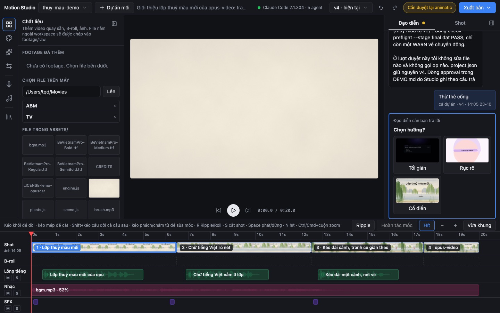

# Motion Studio

**English** · [Tiếng Việt](README.vi.md)

**A video editor where an AI director builds the video and you make the decisions.** Motion Studio is a web app that runs on your own computer. You create a project, add footage, brief the director in plain language, approve its choices on cards, adjust the result on a CapCut-style timeline, and export an MP4 or a layered project for Final Cut Pro, Premiere and DaVinci Resolve. After the first start you do not need a terminal. The interface is in Vietnamese; this guide gives an English gloss next to each label.

[](https://github.com/abm-dungtq/motion-studio/releases/tag/v2.0.0)
[](LICENSE)




[Why](#why-motion-studio) · [Features](#features) · [Quick start](#quick-start) · [First project](#your-first-project) · [Timeline](#timeline) · [Export](#export-to-your-editor) · [Library](#reference-library) · [Lemo-Opuscar](#lemo-opuscar) · [Developers](#for-developers) · [Work with us](#work-with-us) · [License](#license)

---

## Why Motion Studio

AI can now build a whole video, but most tools make you pick one of two shapes. A chat box hands you a finished file you cannot fix, or a classic editor treats the AI as a plug-in on the side. Motion Studio puts both in one window.

- **The director is your own Claude Code.** Studio runs the `claude` CLI that is already signed in on your machine, and the director remembers the project. You do not need another AI subscription. Data leaves your computer only through calls made by your agent and by services you approve.
- **You stay in charge.** When the director needs a decision, such as which of three looks to use or whether the animatic is good, it asks on a card and waits. Only you can approve a direction or a cut; the director cannot approve its own work.
- **Every edit is a version.** Dragging a shot, retiming a line or moving a sound effect creates one numbered version with undo and redo, whether you made the edit or the director did.
- **Private by design.** Studio listens on `127.0.0.1` only, rejects requests from other web pages, and never reads, prints or copies your API key files.

## Features

| | |
|---|---|
| **AI director** | Multi-turn chat with the director; approval cards for directions, animatics and scenes; suggestion cards that rank directions and styles from your brief; a status chip that shows whether `claude` is installed and signed in |
| **Timeline** | Shot, B-roll, Voice, Music and SFX tracks; ripple and roll trims; cut a shot at the playhead; snapping to shots, lines, beats and word starts; waveforms; mute and solo; editable beat and word markers; gate chips that say what still blocks export |
| **Look and motion** | 59 code-driven visual styles from lemo-opuscar in 11 groups, applied to the whole project or to one shot; a transition library with live previews (54 entries with the default provider and HyperFrames installed); four anime packs (impact frame, smear cut, ink wipe, speed lines); a clip fixer for trims, speed, freeze frames, LUTs and reframing |
| **Footage** | Browse your disk and register video, audio and images; a content-hashed B-roll index that finds shots from a description in Vietnamese or English and places them with undo |
| **Reference library** | About 1,250 videos made with Claude Opus 5.5, 200 of them explained in Vietnamese, plus scene techniques, style recipes and prompt templates |
| **Series production** | Shared characters, voices, backgrounds and tools across episodes; asset boards to approve character sheets and backgrounds; batch image generation with self-checks; a voice per character; rebuild and approve one scene without re-rendering the episode |
| **Delivery** | One-click MP4 export and compression; versions for YouTube, Facebook and TikTok; titles and descriptions with chapters; SRT captions; three thumbnail options; upload to Google Drive after you consent |
| **Trust** | Consent cards before any job that spends credits (Codex, ElevenLabs, Drive); receipts with a pass, warn or fail verdict from built-in quality checks; a "Cần xử lý ngoài" (needs outside help) card when a step fails twice, with text you can paste into Claude Code |
| **Open ends** | MCP tools for Claude Code, Codex, Antigravity and opencode; a provider contract; plug-in folders for routes, tabs, tools, quality checks and agent CLIs |

## Quick start

You need Node.js 22.18 or later and ffmpeg with ffprobe. For the AI director you also need Claude Code (`claude`) installed and signed in.

```bash
git clone https://github.com/abm-dungtq/motion-studio ~/Projects/motion-studio
cd ~/Projects/motion-studio && npm run setup
node bin/motion-studio.mjs start --background
```

Then open `http://127.0.0.1:4317`.

`npm run setup` builds the interface and compares the default provider, the [opus-video](https://github.com/abm-dungtq/opus-video) plugin, with its latest release on GitHub. If the plugin is missing or out of date, setup asks "Cài/cập nhật opus-video bản mới nhất? [Y/n]" (Install or update opus-video to the latest version?). A git checkout is updated with `git pull --ff-only`, and is left alone if it has uncommitted changes or is on another branch. Any other copy goes through the plugin's official installer, which backs up the old copy first. Options: `--yes` (do not ask), `--ref <branch or tag>`, `--host claude|codex|all`.

```bash
node bin/motion-studio.mjs status                 # running <url> … | stopped
node bin/motion-studio.mjs stop                   # stop the server and every job
node bin/motion-studio.mjs start --background --root <folder that holds your projects>
```

Each project is a sub-folder with a `project.json`. Studio picks the projects folder from `--root`, then `MOTION_STUDIO_ROOT`, then the folder of the previous run.

### Upgrading from 1.x

Version 2.0 rewrote the interface in React, TypeScript, Tailwind and shadcn/ui with a dark, NLE-style layout. Run `npm run setup` once after you pull. The `public/` folder is gone, so interface extensions now live in `ui/src/ext/<name>/index.ts` (see [docs/extensions.md](docs/extensions.md)). Node.js 22.18 or later is required.

## Your first project

1. Click **Dự án mới** (New project) in the top bar. Enter a folder name, an aspect ratio (16:9, 9:16 or both), a topic and a duration, and pick a mode: **Làm từ đầu** (from scratch), **Dựng từ video có sẵn + B-roll** (edit existing video with B-roll), **Theo bài nhạc** (cut to music) or **Mẫu nhanh** (quick template). The optional field "Việc đầu tiên giao cho AI" (First task for the AI) gives the director its first job.
2. Add footage in the **Chất liệu** (Materials) tab. Files from outside the projects folder are copied into `footage/raw/`.
3. Talk to the director in the right-hand column. When it offers directions or an animatic, approve or reject them on the cards.
4. Adjust the result on the timeline (next section).
5. Open the **Xuất bản** (Publish) menu and choose **Xuất video** (Export video) for an MP4, or **Xuất bộ lớp dựng** (Export layer bundle) to keep editing in another editor.

## Timeline

Dragging shows a preview in place. When you release, Studio sends one patch, which becomes one version.

- **SFX:** drag to move. Right-click "Thêm SFX tại đây…" (Add SFX here) to pick a file from the project or from `shared-assets/sfx/`. Delete removes only sound effects added in Studio; for the director's own effects, Studio offers "Nhờ đạo diễn" (Ask the director).
- **Music:** drag the body to move it and the edges to trim it. The inspector sets volume, fade in and fade out. Fades are heard only in the exported video.
- **Cut a shot:** select it, place the playhead inside it and press S. The new shot is empty, and Studio offers "Nhờ đạo diễn dựng shot mới" (Ask the director to build the new shot).
- **Snap** (N, or the "Hít" button) to the playhead, shot edges, lines, SFX, beats and word starts.
- **M/S** on a track label mutes or solos that track in the player only.
- **Gate chips** next to the Xuất bản menu say "Cần duyệt lại animatic" (the animatic needs re-approval) or "Chưa đủ cổng xuất" (export gates not met). Click one to open the card or the list of failures.

### Keyboard shortcuts

Shortcuts are off while you type in a field, while a dialog or menu is open, or while focus is on the tab rail. Alt+1…9 picks a tab on the rail.

| Key | Action |
|---|---|
| Space | Play / pause |
| J / K / L | Back one second / pause / play |
| ← / → | Back / forward one frame |
| Shift+← / Shift+→ | Back / forward one second |
| Home / End | Start / end of the video |
| S | Cut the selected shot at the playhead |
| Delete / Backspace | Delete the selected SFX (Studio-added only) |
| N | Snap on / off |
| R | Shot edge mode: Ripple (the video gets longer or shorter) or Roll (only the cut point moves) |
| Shift+drag a line | Move that line and the lines after it in the same shot |
| = or + / - | Zoom in / out |
| Shift+Z | Fit to view |
| Cmd/Ctrl+Z | Undo |
| Cmd/Ctrl+Shift+Z, Ctrl+Y | Redo |

More in [docs/timeline.md](docs/timeline.md).

## Export to your editor

"Xuất bộ lớp dựng" (Export layer bundle) in the Xuất bản menu splits a project into layers you can keep cutting in CapCut, Final Cut Pro, Premiere or DaVinci Resolve. The same command from a terminal:

```bash
node bundle.mjs --project <project folder> [--ratio 9x16] [--source <rendered mp4>] [--out <folder>]
```

The bundle in `renders/<project>-<time>[-<ratio>]-bundle/` holds:

- `shots/NN-<shot>.mp4`: each shot as H.264 CRF 12 without sound, cut on frame-accurate shot boundaries;
- `audio/mix.wav`, `voice.wav`, `music.wav`, `sfx.wav`: the full mix and the stems at 48 kHz, as long as the video;
- `captions.srt`, split on word timings;
- `manifest.json` (schema `motion-studio/bundle@1`);
- `timeline.fcpxml` (Final Cut Pro, DaVinci Resolve), `timeline.xml` (Premiere, Resolve) and `timeline.otio` (OpenTimelineIO), with the shots in order, each stem on its own track, and markers for lines and SFX.

Transitions are baked into the shots they span, so the shots join seamlessly as long as you keep their order and length. Details and limits: [docs/nle-export.md](docs/nle-export.md).

## Reference library

The **Thư viện mẫu** (Reference library) tab has four sections: **Video mẫu** (sample videos), **Cảnh mẫu** (scene techniques), **Phong cách** (style recipes) and **Prompt mẫu** (prompt templates). You can search in Vietnamese with or without diacritics, or in English. You can browse and copy prompts without opening a project. Inside a project, "Dùng cho dự án" (Use for this project) sends the sample and its notes to the director.

Prompt templates start with Studio's own two: a six-part prompt frame, and the Lemo-Opuscar directing frame described in the next section.

Cover images are not in the repository. Download them once (about 25 MB) to `~/.cache/motion-studio/library/thumbs`:

```bash
node scripts/library-thumbs.mjs
```

Sources, licences and how to rebuild the data are in [library/SOURCES.md](library/SOURCES.md).

## Lemo-Opuscar

[Lemo-Opuscar](https://lemomo-ai.github.io/lemo-opuscar/) by LemoLab is a set of 59 film styles. Each style is a style prompt plus a short film built entirely in code. Motion Studio uses it in two places:

- **The Phong cách (Styles) tab** lists the 59 styles in 11 groups, with frames, Vietnamese names and the `STYLE.md` of each style. "Áp cho dự án" (Apply to project) applies a style to the whole project; in the shot inspector, "Áp phong cách cho shot này" (Apply style to this shot) applies it to one shot. Every style is built inside the project's own HyperFrames composition, so the player, timeline and export work as usual. On first use the tab offers "Tải thư viện (≈ 5 MB)" (Download library), which fetches data only, pinned to one commit. The director can also draft a style of your own, and "Giữ phong cách" (Keep style) saves it to `~/lemo-my-styles/`, the folder the lemo-opuscar plugin uses.
- **The directing-frame prompt template** in Prompt mẫu is a Vietnamese rewrite of lemo-opuscar's `DIRECTOR.md`: read `STYLE.md`, ask once, choose references, write a treatment before watching the sample film, three style frames, lock the music grid, one review pass, and differ from the sample film on four of six points. Use it with a style from the Phong cách tab, especially for a project created in Mẫu nhanh mode.

How each style is applied, own styles, and how to move the pin: [docs/lemo-styles.md](docs/lemo-styles.md).

lemo-opuscar code and docs are MIT; frames and sample films are CC BY 4.0, credit LemoLab. Films you make with these styles are yours.

## For developers

<details>
<summary><b>Extension points</b></summary>

Add a feature by adding a file, without touching `server.mjs` or the shell in `ui/src/shell/`:

- `routes/*.mjs`: HTTP routes. Studio's own routes are tried first; a clash stops Studio at start-up.
- `ui/src/ext/<name>/index.ts`: export `register(studio)` and call `registerTab`, `registerSection`, `registerInspectorSection`, `registerAgentRows` or `registerTimelineDecorator`.
- `lib/tools/*.mjs`: tools for the AI director and MCP clients.
- `lib/quality/*.mjs`: checks that run on every file Studio produces; results land in `<project>/.opus/receipts/`.
- `lib/agents/cli/*.mjs`: local agent CLIs (claude, codex, codex-pool, agy, gemini, cursor-agent, opencode) for writing, reading images and generating images.

Working examples: [docs/extensions.md](docs/extensions.md). Agents and fallback order: [docs/agents.md](docs/agents.md). MCP: [docs/mcp.md](docs/mcp.md). Receipts and quality thresholds: [docs/receipts.md](docs/receipts.md).

</details>

<details>
<summary><b>Provider and compatibility</b></summary>

Everything Studio needs from outside goes through `lib/provider.mjs`: reading and validating `project.json`, the command gateway (patch, undo, redo, history), the director's request queue, tools and prompt text for `claude -p`, command paths (render, mix, pitch, import, demo, preflight, timing and more) and library files. The contract is documented at the top of that file.

Adapters live in `lib/providers/`, one file per provider shipped with Studio; Studio never loads code from outside the repository. Today there is `lib/providers/opus-video.mjs`. The provider loads lazily: if it is missing or incompatible, the server still runs, `GET /api/status` explains what is wrong, and routes that need it answer 503 with the reason. Installing the provider does not require a restart.

Motion Studio 2.0 needs opus-video 2.x that declares `STUDIO_API` 3 or 4 and the project schema `opus-video/project@1`. The check is `NEED` in `lib/providers/opus-video.mjs`.

</details>

<details>
<summary><b>Environment variables</b></summary>

| Variable | Purpose |
|---|---|
| `MOTION_STUDIO_ROOT` | Folder that holds your projects |
| `MOTION_STUDIO_PORT` | Port (default 4317), for a test Studio beside the real one; pair it with its own `MOTION_STUDIO_STATE` |
| `MOTION_STUDIO_STATE` | State file (default `~/.config/motion-studio/studio.json`, chmod 600) |
| `MOTION_STUDIO_COMPRESS` | Compression command after export (default `<root>/scripts/compress-final.sh`) |
| `MOTION_STUDIO_PROVIDER` | Provider in `lib/providers/` |
| `MOTION_STUDIO_HF_RUNTIME`, `MOTION_STUDIO_HF_SKILLS` | HyperFrames runtime file for the player; HyperFrames skill folder (default `~/.claude/skills`) |
| `MOTION_STUDIO_AGENT_PATH` | Search path for agent CLIs; when set, Studio looks only there |
| `MOTION_STUDIO_GWS` | The `gws` binary used for Google Drive uploads |
| `MOTION_STUDIO_CACHE`, `MOTION_STUDIO_BROLL_CACHE`, `MOTION_STUDIO_LEMO_CACHE`, `MOTION_STUDIO_THUMBS` | Cache folders (default under `~/.cache/motion-studio/`) |
| `LEMO_MY_STYLES` | Folder for your own lemo-opuscar styles (default `~/lemo-my-styles/`) |
| `OPUS_VIDEO_HOME` | opus-video plugin folder (default provider only); when set, Studio uses only that folder |
| `MOTION_STUDIO_HOME` | Read by the opus-video plugin's shim, not by Studio: where the shim finds Studio |

The old names `OPUS_STUDIO_ROOT`, `OPUS_STUDIO_STATE`, `OPUS_COMPRESS_FINAL` and `OPUS_HF_RUNTIME` still work with a one-time warning, as does the legacy default projects folder `/Volumes/2/Edit-Video`. Both are deprecated and will be removed in a later major release. `OPUS_STUDIO_RUNNER` and `OPUS_STUDIO_REQUEST` keep their names because they are the protocol with the plugin's MCP server.

</details>

<details>
<summary><b>Tests</b></summary>

```bash
npm test
```

This runs the server tests (`node --test tests/*.test.mjs`) and then the interface tests in `ui/`. Most server tests need the default provider installed (set `OPUS_VIDEO_HOME` if the plugin lives elsewhere). `tests/no-provider.test.mjs` and `tests/config.test.mjs` run without it.

</details>

The full history is in [CHANGELOG.md](CHANGELOG.md).

## Work with us

Motion Studio is free and open source under the MIT license. If you want it set up for your team, a provider for your own pipeline, custom tabs or tools, or help producing videos with it, [open an issue](https://github.com/abm-dungtq/motion-studio/issues) or reach out through [@abm-dungtq](https://github.com/abm-dungtq) on GitHub.

## License

MIT, see [LICENSE](LICENSE). The lemo-opuscar styles are MIT, with frames and films under CC BY 4.0 (credit LemoLab). Library data sources and their licences are listed in [library/SOURCES.md](library/SOURCES.md).
