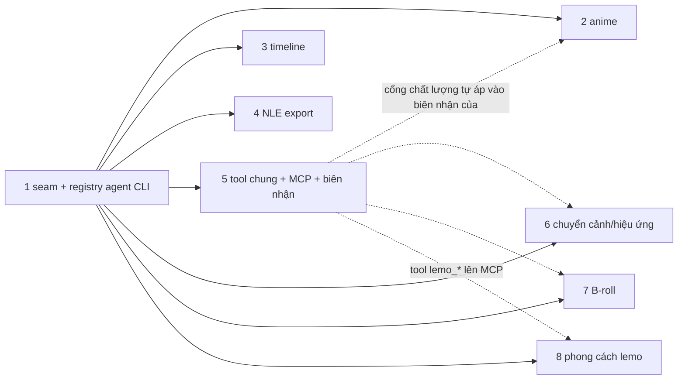

# Nâng cấp Motion Studio học từ GitHub

Ngày lập: 2026-10-23 (Asia/Saigon). Repo `/Volumes/2/Motion-Studio`, nhánh `main` ở `d2d5562`. Mỗi phase làm trong một git worktree riêng và mở một PR vào `main`.

## Kết quả cần có

Studio biết trên máy có những agent CLI nào và mỗi cái làm được gì: chữ, đọc ảnh, sinh ảnh, còn quota hay không. Mọi tính năng khác gọi qua một registry chung. Trên nền đó có thêm bảy nhóm tính năng:

- pipeline anime motion-comic;
- timeline nâng cấp;
- export FCPXML, xmeml và OTIO;
- một bộ tool dùng chung cho đạo diễn và client MCP ngoài, có biên nhận và cổng chất lượng;
- chuyển cảnh và công cụ dựng tất định;
- chỉ mục hiểu B-roll có cache;
- thư viện 59 phong cách code của lemo-opuscar, áp theo dự án hoặc shot, cùng phong cách riêng.

Các phase sau không sửa file lõi dùng chung. Mỗi phase chỉ thêm file mới, được nạp tự động qua seam mà phase 1 dựng.

## Nguồn đã đọc

- Tư vấn: `/Volumes/2/Edit-Video/plans/reports/advisor-261022-1723-motion-studio-decouple-and-repo-research.md` (bảng 22 repo, mục C).
- Plan và báo cáo trước: `/Volumes/2/Motion-Studio/plans/261022-1857-provider-boundary/` (contract provider, PR upstream STUDIO_API 4 đã có trong plugin 2.5.0).
- `README.md`. Handoff anime: `/Volumes/2/Edit-Video/zoro-vs-mihawk/plans/handoffs/anime-motion-comic-20261022-1657.md`.

## Baseline hôm nay: 111/112, không phải 112

`npm test` chạy được 112 test, 111 đạt, 1 trượt: `tests/provider.test.mjs:27`.

- Test đòi mọi giá trị trong `p.commands` là một đường dẫn chuỗi `.mjs`.
- Plugin đã cài lên 2.5.0 (STUDIO_API 4). Ở bản này `COMMANDS.choose` là object `{ file, args }`.
- `gates.mjs:21-24` (`chooseArgv`) đã xử lý đúng dạng object này. Vậy lỗi nằm ở test, không ở mã.

Phase 1, bước 0 sửa test này. Từ đó baseline là 112/112, và mọi phase sau tính từ con số này.

## Phase

| # | Phase | Worktree / nhánh | Effort | Phụ thuộc | File |
|---|---|---|---|---|---|
| 1 | Seam mở rộng + registry agent CLI | `agent-registry` | 10h | không | [phase-01-seams-and-agent-registry.md](phase-01-seams-and-agent-registry.md) |
| 2 | Pipeline anime motion-comic | `anime-pipeline` | 12h | 1 (sinh ảnh) | [phase-02-anime-motion-comic.md](phase-02-anime-motion-comic.md) |
| 3 | Nâng cấp timeline | `timeline-upgrade` | 12h | 1 (seam UI) | [phase-03-timeline-upgrade.md](phase-03-timeline-upgrade.md) |
| 4 | Export NLE (FCPXML, xmeml, OTIO) | `nle-export` | 6h | 1 (seam tool) | [phase-04-nle-export.md](phase-04-nle-export.md) |
| 5 | Bộ tool chung + MCP + biên nhận + cổng chất lượng | `agent-tools` | 9h | 1 (seam tool, receipt) | [phase-05-agent-mcp-tooling.md](phase-05-agent-mcp-tooling.md) |
| 6 | Chuyển cảnh và hiệu ứng dựng | `fx-transitions` | 10h | 1 (seam UI, receipt) | [phase-06-transitions-and-effects.md](phase-06-transitions-and-effects.md) |
| 7 | Hiểu B-roll có sẵn | `broll-index` | 10h | 1 (đọc ảnh) | [phase-07-broll-understanding.md](phase-07-broll-understanding.md) |
| 8 | Phong cách code lemo-opuscar | `lemo-opuscar` | 8h | 1 (seam UI, route, tool) | [phase-08-lemo-opuscar-integration.md](phase-08-lemo-opuscar-integration.md) |

Worktree nằm ở `/Volumes/2/Motion-Studio/.claude/worktrees/<tên>`, nhánh `feat/<tên>`. Tạo bằng lệnh sau, từ `main` đã có phase 1:

```bash
git -C /Volumes/2/Motion-Studio worktree add .claude/worktrees/<tên> -b feat/<tên> main
```

## Đồ thị phụ thuộc



- **Phụ thuộc cứng vào phase 1:** cả bảy phase sau. Phase 2 cần `generateImage()`, phase 7 cần `describeImages()`. Phase 3, 4, 5, 6 và 8 cần các seam: route, UI, tool, receipt.
- **Phụ thuộc mềm, nét đứt:** phase 2, 6 và 7 ghi biên nhận qua `lib/receipts.mjs` của phase 1. Bộ kiểm chất lượng thật do phase 5 thêm vào `lib/quality/`, và được nạp tự động. Merge trước hay sau phase 5 đều chạy: chưa có phase 5 thì biên nhận chỉ có hai kiểm cơ bản của phase 1.
- Phase 2 đến 8 chạy **song song**, sau khi phase 1 đã merge vào `main`.

## Seam do phase 1 dựng (để các phase sau không sửa file chung)

Chi tiết nằm ở phase 1. Tóm tắt:

| Seam | Cơ chế | Phase sau làm gì |
|---|---|---|
| Route | `lib/routes.mjs` nạp mọi `routes/*.mjs` (như `lib/provider.mjs:35` nạp adapter), mỗi file `export const ROUTES` | thêm `routes/<tên>.mjs` |
| UI | `GET /api/extensions` liệt kê `public/ext-*.js` / `ext-*.css`; `public/ext.js` import rồi gọi `register(studio)` | thêm `public/ext-<tên>.js` và các file `public/<tiền tố>-*.js` |
| Tab, mục trong tab, inspector, popover agent, trang trí timeline | `studio.addTab`, `addSection`, `addInspectorSection`, `addAgentRows`, `addTimelineDecorator` | gọi trong `register()` |
| Tool | `lib/tools.mjs` nạp `lib/tools/*.mjs` | thêm `lib/tools/<tên>.mjs` |
| Biên nhận và kiểm chất lượng | `lib/receipts.mjs` + `lib/quality/*.mjs` (nạp tự động) | gọi `writeReceipt`; phase 5 thêm kiểm |
| Lệnh của provider | adapter thêm sẵn `timing`, `beatGrid`, `wordSync`, `sfxSync`, `cut`, `reframe`, `qc` | dùng `P.commands.<tên>`, không ghi tên script |
| Agent CLI | `lib/agents/index.mjs`: `listAgents`, `generateImage`, `describeImages`, `complete` | gọi hàm, không tự spawn CLI |

## Bảng sở hữu file (phase 2–8 chạy song song)

Không có hai phase song song nào cùng sửa một file. Mỗi file mới mang tiền tố của phase mình. Bảng đầy đủ nằm trong từng phase.

| File có sẵn | Ai sửa |
|---|---|
| `server.mjs`, `agent.mjs`, `lib/config.mjs`, `lib/provider.mjs`, `public/agent.js`, `public/panels.js`, `public/icons.js`, `tests/provider.test.mjs` | chỉ phase 1 |
| `lib/providers/opus-video.mjs` | phase 1; sau đó chỉ phase 8 thêm đúng một khoá `lemo` vào `commands` |
| `public/app.js`, `public/index.html`, `public/inspector.js` | phase 1 thêm seam; sau đó chỉ phase 3 |
| `public/timeline.js` | phase 1 thêm `addTimelineDecorator`; sau đó chỉ phase 3 |
| `public/timeline-edit.js`, `public/waveform.js`, `public/player.js`, `public/app.css` | chỉ phase 3 |
| `bundle.mjs` | chỉ phase 4 |
| `director.mjs` | chỉ phase 5 |
| `media.mjs` | chỉ phase 7 |
| `jobs.mjs`, `gates.mjs`, `create.mjs`, `lib/library.mjs`, `lib/setup.mjs`, `bin/motion-studio.mjs` | không phase nào (chỉ import) |
| `README.md` | Phase 1 thêm mục "Tính năng mở rộng" trỏ tới `docs/`. Phase khác viết tài liệu vào `docs/<tên>.md`. Ngoại lệ: một phase làm cũ một dòng README (bảng phím, bảng env, mục Bộ lớp dựng) thì sửa đúng dòng đó ở commit cuối khi rebase, như luật CHANGELOG |
| `CHANGELOG.md` | mỗi PR thêm **một dòng** ở commit cuối, ngay trước khi merge (xem thứ tự merge) |

## Thứ tự merge

1. **Phase 1**, bắt buộc trước. Các worktree 2–8 chỉ được tạo sau khi phase 1 đã merge.
2. **Phase 4**: nhỏ nhất, gần như chỉ sửa `bundle.mjs`.
3. **Phase 5**: thêm kiểm chất lượng. Phase merge sau nó có biên nhận đầy đủ ngay.
4. **Phase 3**: sửa nhiều UI lõi nhất. Merge sớm để phase 6 và 7 rebase lên timeline mới và chạy thử trên đó.
5. **Phase 6**.
6. **Phase 8**: chỉ thêm file và một khoá của adapter. Merge sau phase 3 để thử tab và inspector trên UI mới.
7. **Phase 7**.
8. **Phase 2**: rộng nhất và tốn quota sinh ảnh khi thử thật. Merge cuối để dùng được mọi thứ phía trên.

Merge theo thứ tự này cũng để biết test xanh hay đỏ là do phase nào.

Trước khi merge, PR nào cũng làm các bước sau:

1. `git fetch && git rebase origin/main`.
2. Thêm một dòng `CHANGELOG.md` dưới "Chưa phát hành". Nếu đụng dòng của PR khác thì giữ cả hai dòng.
3. Chạy `npm test` và dán dòng `ℹ pass N` vào PR.

Nếu hai phase vẫn đụng nhau ở cùng một file, PR merge sau sửa xung đột. Không sửa ngược PR đã merge.

## Luật chung cho mọi phase

- **Không triển khai ngoài phạm vi phase.** Không sửa file thuộc phase khác. Cần sửa thì dừng lại và theo Failure Protocol.
- **Không sửa plugin** `~/.claude/skills/opus-video`. PR upstream làm từ bản clone `/Volumes/2/opus-video-upstream-work` (đã có từ PR STUDIO_API 4), nhánh mới cắt từ `origin/main` của `abm-dungtq/opus-video`.
- **Tên plugin chỉ có trong adapter.** Test `tests/provider.test.mjs:67` chặn chuỗi tên provider mặc định ở mọi file text của repo, kể cả `docs/`. Chỉ `lib/providers/opus-video.mjs`, `README.md`, `CHANGELOG.md`, `plans/`, `tests/fixtures/` được nhắc. Code mới gọi `P.commands.*`, `P.home`, `P.label`.
- **Không có dependency npm, không bước build** (README "Cần có"). Thư viện chép về thì vendor vào `lib/vendor/<tên>/` hoặc `public/vendor-<tên>.js`. Dòng đầu file ghi URL nguồn, commit và giấy phép. Repo này học tập nên được chép mã mọi giấy phép, nhưng vẫn phải ghi nguồn.
- **Không in bí mật.** Không đọc, `cat` hay in `~/.config/opus-video/.env`, `~/.codex*/auth.json`, `~/.gemini/*token*`, `~/.config/cx-image/config.json`, Keychain. Chỉ được kiểm file có tồn tại. Log của job đi qua bộ lọc che token ở phase 1.
- **Commit và PR:** conventional commit (`feat(agents): …`). Commit và thân PR không nhắc AI hay Claude, không có dòng Co-Authored-By. Không dùng mã phase hay mã audit trong tên test, comment hay commit.
- **Process:** server thử của mỗi phase chạy ở cổng riêng (bảng dưới), và phải dừng trước khi xong phase. Không dừng, không khởi động lại Studio đang chạy ở `127.0.0.1:4317`. Footage và media thô không đặt trong repo.
- **Mã chép từ GitHub** thì clone vào `/tmp/ms-ref/<repo>`, mỗi repo một thư mục mới. Không chạy script, không `npm install` trong đó, chỉ đọc.

| Phase | Cổng server thử |
|---|---|
| 1 | 4401 |
| 2 | 4402 |
| 3 | 4403 |
| 4 | 4404 |
| 5 | 4405 |
| 6 | 4406 |
| 7 | 4407 |
| 8 | 4408 |

### Cách chạy server thử

`bin/motion-studio.mjs:33` ghim cổng `PORT = 4317` và ghi file trạng thái chung. Vì vậy server thử **không** chạy bằng `bin`. Mỗi phase dùng một script tạm ngoài repo, `/tmp/ms-smoke-<phase>.mjs`:

```js
import { createServer } from "<worktree>/server.mjs";
const s = createServer({ root: "/Volumes/2/Edit-Video", token: "smoke-<phase>" });
s.listen(<cổng>, "127.0.0.1", () => console.log("http://127.0.0.1:<cổng>/"));
```

Chạy script này bằng background-run của harness (ghi lại PID). Chạy xong thì `kill <PID>` rồi kiểm `lsof -i :<cổng>` rỗng.

Server thử dùng chung thư mục gốc `/Volumes/2/Edit-Video` với server 4317. Chỉ thao tác trên dự án thử `ms-smoke-<phase>`, tạo bằng `scripts/new-project.sh`. Xoá dự án đó khi xong, kèm xác nhận của người dùng theo luật dọn file của workspace. Dự án thật chỉ được đọc, trừ khi người dùng cho phép.

## Ma trận test (tóm tắt)

| Lớp | Cách kiểm | Ở đâu |
|---|---|---|
| Unit | `node --test` trên hàm thuần: router agent, parser `codex-pool status`, bộ ghi FCPXML/OTIO, ops ripple/roll, parser manifest anime, khoá cache B-roll | `tests/<tên>.test.mjs` của từng phase |
| Tích hợp | `createServer({ root, token, routesDir? })` trên cổng 0, CLI giả trên `PATH` (script shell in sẵn output), ffmpeg thật trên media sinh bằng `lavfi` | từng phase |
| E2E thủ công | server thử ở cổng của phase, thao tác bằng trình duyệt, chụp ảnh lưu ngoài repo ở `/Volumes/2/Edit-Video/plans/reports/` | tiêu chí nghiệm thu của phase |
| Hồi quy | `npm test` toàn bộ = 112 + số test mới, 0 fail | mọi PR |

## Hoàn tác

- Mỗi phase là một PR riêng. Hoàn tác bằng `git revert -m 1 <merge sha>`.
- Phase 2–8 chỉ thêm file vào thư mục seam. Revert là gỡ hẳn tính năng, các phase khác không vỡ, vì seam nạp được thư mục rỗng.
- Revert phase 1 kéo theo mọi phase sau. Nếu phải làm, revert ngược thứ tự merge.
- Dữ liệu người dùng Studio ghi ra đều nằm ngoài `project.json`, không đổi schema của provider:
  - `.opus/receipts/` và `.opus/timing-edits/` (có bản sao lưu);
  - `assets/chars/chars.json`;
  - `~/.cache/motion-studio/broll/`;
  - `.opus/lemo.json`, `~/.cache/motion-studio/lemo-opuscar/` (phong cách đã giữ trong `~/lemo-my-styles/` là của người dùng, không tự xoá).

  Xoá các file này không làm hỏng dự án.

## Tiêu chí xong của cả plan

- 8 PR đã merge theo thứ tự ở trên. `npm test` trên `main` đạt 0 fail, số test ≥ 112 + tổng số test mới mà các phase ghi.
- Grep tên provider ngoài các file được phép: 0 dòng (test `provider.test.mjs:67` xanh).
- Chip agent liệt kê ít nhất `claude`, `codex`, `codex-pool`, `agy` và `opencode` đúng như máy này đang có, kèm phiên bản, trạng thái đăng nhập, khả năng và quota của `codex-pool`.
- Mỗi tính năng có một file `docs/<tên>.md` mô tả cách dùng.

## PR upstream có thể cần (chỉ khi điều kiện xảy ra)

| Phase | Khi nào cần | Nội dung |
|---|---|---|
| 3 | Người dùng muốn track overlay/B-roll có thời gian tự do (không gắn vào shot) | schema + op gateway `add_overlay` / `move_overlay` / `remove_overlay` |
| 6 | `check-preflight` hoặc `recipe-pack` từ chối mã chuyển cảnh mới trong PLAN.md | thêm seam id mới vào danh sách seam của plugin |
| 5 | Client MCP ngoài cần actor riêng trong lịch sử | thêm `"agent"` vào `ACTORS` (`gateway.mjs:58`) |

Các phase 1, 2, 4, 7 và 8 không cần PR upstream. Phase 8 chỉ mở PR khi người dùng muốn thêm một phong cách lớp canvas thứ ba (xem phase 8).

## Câu hỏi chưa giải quyết

1. **Track overlay tự do (phase 3).** Bản đầu làm multi-track bằng các làn: nhạc chồng nhau, SFX xếp tầng, làn B-roll lấy từ `shot.assets`. Đặt clip ở thời điểm bất kỳ thì cần PR schema upstream. Bạn có cần ngay không?
2. **Quota khi thử thật.** Nghiệm thu phase 1 và 2 tốn khoảng 1–3 ảnh từ quota Codex, phase 7 tốn khoảng 1–2 lượt đọc ảnh. Tài khoản 2 từng hết credit (handoff), nay `codex-pool status` báo `acct2: OK`. Có cần hỏi lại trước mỗi lần chạy không?
3. **Thứ tự ưu tiên agent.** Mặc định đề xuất cho sinh ảnh là `codex-pool` → `codex` → `agy`, cho đọc ảnh là `agy` → `codex-pool` → `claude`. Lý do: để quota Claude cho đạo diễn. Bạn đổi được trong `studio.json`.
4. **Worktree cũ** `.claude/worktrees/fix-gate-card-clicks-603ec4` (nhánh `claude/fix-gate-card-clicks-603ec4` ở `0f85bf5`) không có commit nào ngoài `main` và không có thay đổi chưa commit. Có thể gỡ bằng `git worktree remove`, nhưng plan không tự gỡ vì có thể có phiên khác đang dùng nó. Bạn muốn gỡ không?
