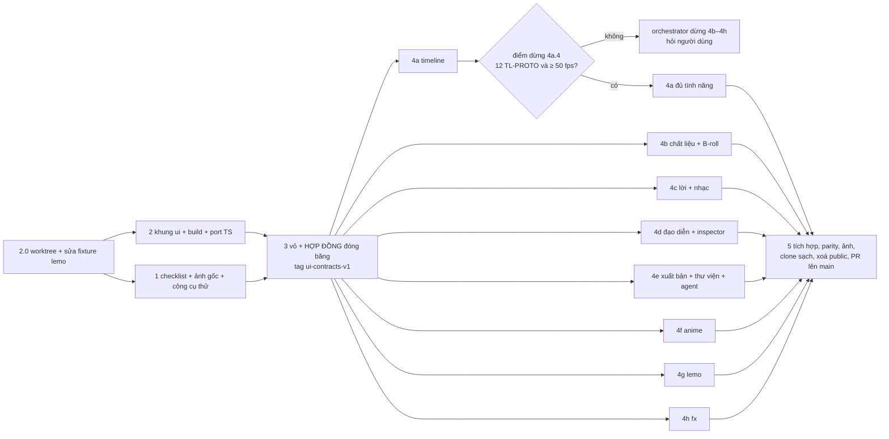

# Viết lại giao diện Motion Studio bằng React

Plan lập ngày 2026-10-23 (Asia/Saigon), trên repo `/Volumes/2/Motion-Studio`, nhánh `main` ở commit `d1a0216`. Plan viết theo kiểu handover (`--advice`):

- mỗi task có Mục tiêu, File, Các bước, Đạt khi và Verify cơ học;
- mỗi phase có Failure Protocol riêng;
- một Verify trượt thì dừng. Dừng như vậy là đúng quy trình, không phải bị kẹt.

**Cách chia việc** (theo yêu cầu chạy song song tối đa):

- **Xương sống nối tiếp ngắn:**
  - phase 1 và phase 2 chạy song song;
  - phase 3 dựng vỏ và **đóng băng hợp đồng chung**.
- **Tỏa ra:** tám agent làm song song (4a–4h). Mỗi agent có worktree, nhánh, cổng thử riêng, và sở hữu một tập file không giao nhau trong `ui/src/`.
- **Phase cuối nối tiếp (5):** tích hợp, chạy parity đầy đủ, chụp ảnh, thử clone sạch, xoá `public/`, rồi mở một PR lên `main`.

## Kết quả cần có (hợp đồng đã chốt, không mở lại)

Studio ở `127.0.0.1:4317` chạy giao diện React mới, dark theme kiểu NLE, bố cục theo mockup `/Volumes/2/Edit-Video/plans/reports/advise-261023-1018-studio-ui-preview.html` (ảnh `.png` cạnh nó). Thư mục `public/` cũ bị xoá trong cùng merge. Mọi tính năng cũ còn đủ.

### Tiêu chí xong

1. Studio ở 4317 chạy UI React mới, sau khi merge và chuyển đổi ở task 5.10.
2. `public/` cũ bị xoá trong cùng merge.
3. `npm test` xanh (`ℹ fail 0`), có thêm test UI (vitest) và test build/serve.
4. Checklist parity `parity-checklist.md` được kiểm trực tiếp 100%. Checklist phủ:
   - mọi tab, mọi mục, mọi phím tắt trong bảng README;
   - Roll/Ripple, Shift+kéo câu, S cắt shot, hít (N, nút "Hít");
   - các làn: nhạc nhiều làn, SFX xếp tầng, làn B-roll nhận thả;
   - mốc phách và mốc từ kéo được;
   - thẻ chọn hướng và thẻ duyệt animatic;
   - xuất video, xuất bộ lớp dựng NLE.
5. Có ảnh chụp mọi tab ở 1440 px và 2560 px.
6. Clone sạch rồi `npm run setup` và `start` chạy được ngay.
7. **Thanh trên:** chọn dự án, Dự án mới, chip agent, chọn phiên bản, hoàn tác/làm lại, nút Xuất bản dạng menu thả xuống. Tab Xuất bản bị bỏ khỏi rail.
8. **Rail trái:** chỉ icon, có tooltip, chia ba nhóm:
   - Chất liệu, Phong cách, Anime, Chuyển cảnh & hiệu ứng;
   - Lời & giọng, Nhạc & âm thanh;
   - Thư viện mẫu.
9. **Cột phải** có hai tab:
   - Đạo diễn: chat bền với đạo diễn, có chấm báo khi một thẻ cổng đang chờ;
   - Shot: inspector. Bấm một khối trên timeline thì chuyển sang tab này.
10. Panel trái và cột phải thu gọn được và kéo đổi cỡ được.
11. Khung xem trước là sân khấu nền đen. Khi player chưa có composition để chiếu, khung hiện ảnh khung của bản render mới nhất.
12. Mọi extension (anime, broll, fx, lemo, receipts, agents) viết lại bằng React qua API component `registerTab` / `registerSection`, có tài liệu và test.

### Ngoài phạm vi

- Đổi API server (`/api/*`). Đổi cách phục vụ file tĩnh (`/`, `/assets/*`) thì **được**, vì đó không phải API (xem phase 2).
- Đổi tính năng. Plan chỉ đổi chỗ đặt trong bố cục mới.
- Theme sáng.
- Giữ `/classic`.
- Commit output build (`ui/dist/`).

### Ràng buộc

- Nhánh tích hợp là `feat/react-ui`, worktree `/Volumes/2/Motion-Studio/.claude/worktrees/react-ui`. Nhánh vùng là `feat/react-ui-<vùng>`, cắt từ `feat/react-ui`, và mở PR vào `feat/react-ui`, không vào `main`. UI cũ trên `main` vẫn dùng được tới lúc merge.
- Build lúc `setup`, và lúc `start` khi nguồn mới hơn bản build.
- **Port logic timeline sang `.ts`, không viết lại:** `timeline-edit`, `timeline-lanes`, `timeline-markers`, `peaks-cache`, `gate-cards`, `waveform`, `thumbs` và các module tương tự. Test cũ của chúng phải xanh.
- Conventional commit, không nhắc AI, không có dòng Co-Authored-By. PR cũng không nhắc AI.
- Không đụng server ở 4317 khi thử. Mỗi phase có cổng thử riêng (bảng nhóm song song bên dưới).
- Repo học tập: chép mã GitHub được, nhưng phải ghi nguồn (URL, commit, giấy phép) ở đầu file.

## Dừng và hỏi người dùng (không gọi kongming cho các trường hợp này)

Người thực thi **dừng và hỏi người dùng** khi:

1. Nguyên mẫu timeline ở điểm dừng (task 4a.4) không mượt hoặc thiếu tính năng. Đây là tiêu chí huỷ (xem mục dưới).
2. Cần đổi API server, tức bất kỳ thay đổi nào dưới `/api/` hay trong `routes/*.mjs`.
3. Gặp lỗi không giải thích được, sau khi đã theo Failure Protocol một lần.
4. Cần xoá hay ghi đè file ngoài repo Motion-Studio. Ngoại lệ là thư mục tạm do chính plan này tạo: `/tmp/ms-react-*`, `/tmp/ms-clean-*`.
5. Cần dừng hay khởi động lại server 4317. Việc này chỉ có ở task 5.10, sau khi người dùng đồng ý merge.

Agent của một vùng không hỏi người dùng trực tiếp. Agent báo orchestrator, và orchestrator hỏi.

### Tiêu chí huỷ (kill criterion)

Task 4a.4 là điểm dừng. Nguyên mẫu timeline phải đạt cả hai điều kiện:

- `node ui/scripts/perf-playhead.mjs` trên dự án `perf-60` (60 shot) cho trung vị ≥ 50 fps qua 3 lần chạy, và thoát 0;
- đủ 12 dòng `TL-PROTO-01`…`12` của checklist khi thử trên 4412.

Trượt một trong hai thì orchestrator **dừng mọi agent 4b–4h**. Các agent này làm xong task đang dở nhưng không push. Sau đó orchestrator hỏi người dùng, với hai lựa chọn:

- (a) cho thêm thời gian sửa nguyên mẫu;
- (b) dự phòng: áp token tối và bố cục mới lên UI vanilla `public/`, bỏ React.

Phase 5 không bắt đầu trước khi điểm dừng đạt.

## Quyết định kỹ thuật đã chốt

| Việc | Chọn | Vì sao |
|---|---|---|
| Chạy test `.ts` | `node --test` có sẵn, Node tự bỏ kiểu (type stripping). Test logic cũ trong `tests/*.test.mjs` chỉ đổi đường import sang `../ui/src/core/*.ts` | Máy có Node 24.18.0, `process.features.typescript` = `strip`. Đã thử: một test `.mjs` import `./a.ts` cho `pass 1`, không có cảnh báo. `lib/timing-edit.mjs` (server) cũng import thẳng file `.ts` |
| Test component React (`.tsx`) | vitest, jsdom, @testing-library/react, trong `ui/` | Node không biên dịch JSX. Vitest dùng chung cấu hình Vite |
| `npm test` | `node --test tests/*.test.mjs && npm --prefix ui test`; script `test` của `ui` là `tsc --noEmit && vitest run` (phase 5 thêm test của `check-ownership`) | Một lệnh, có cả kiểm kiểu |
| Yêu cầu Node | 22.18 trở lên (README đang ghi 20) | Đây là bản thấp nhất bật type stripping mặc định. `bin` kiểm `process.features.typescript` và báo rõ khi thiếu |
| Luật cho `ui/src/core/*.ts` | Chỉ cú pháp kiểu xoá được (`erasableSyntaxOnly`); import tương đối có đuôi `.ts`; không alias `@/`; không React | Để Node chạy thẳng được. Có test grep chặn |
| Dependency | `ui/package.json` riêng, có lockfile, **đóng băng sau phase 2**. Server vẫn không có dependency npm | Server không đổi cách chạy. Một danh sách dependency cố định thì tám nhánh không xung đột lockfile |
| Dữ liệu server | TanStack Query; SSE `/api/events` cập nhật cache; mọi route nằm trong `ui/src/api/` | Theo lời khuyên số 5. Một chỗ duy nhất gọi server, nên vùng không phải sửa file chung |
| Trạng thái UI | Một store Zustand nhỏ, hình dạng chốt ở phase 3. State riêng của vùng nằm trong store nhỏ của vùng. Không Redux | Theo lời khuyên số 5 |
| Playhead, waveform | Vẽ qua ref và canvas. Playhead đăng ký `store.subscribe`, không render React mỗi khung | Theo lời khuyên số 4 |
| shadcn | Chỉ Tabs, Dialog, DropdownMenu, Tooltip, Resizable (`react-resizable-panels`), ScrollArea, Select, Slider, Sonner. Icon Lucide | Theo lời khuyên số 3 và 6. Popover agent dùng Dialog; menu chuột phải dùng DropdownMenu neo tại điểm bấm; nút và ô nhập là thẻ HTML gốc, style bằng token |
| Màu | Mọi màu là biến CSS trong `ui/src/styles/tokens.css`. Component chỉ dùng token; canvas đọc token qua `getComputedStyle` | Theo lời khuyên số 2. Có test chặn mã màu thô |
| Nạp phần giao diện | Bộ nạp tự tìm `ui/src/panels/*/index.ts` (phần có sẵn) rồi `ui/src/ext/*/index.ts` (extension). Mỗi thư mục export `register(studio)`. Một module lỗi chỉ hiện toast | Không có file đăng ký chung, nên tám agent không cùng sửa một file. Giữ hợp đồng của `public/ext.js` |
| `GET /api/extensions` | Giữ nguyên route và dạng trả về. Sau khi xoá `public/`, route trả `{ scripts: [], styles: [] }` (`routes/extensions.mjs:12-17` đã bắt lỗi thiếu thư mục) | Bỏ route là đổi API, nằm ngoài phạm vi. Xem câu hỏi mở 1 |
| Tab bị bỏ khỏi rail | `ai` thành tab Đạo diễn ở cột phải; `output` thành hộp thoại "Cổng & tệp đã xuất" mở từ menu Xuất bản. `?tab=ai` và `?tab=output` vẫn mở đúng chỗ mới | Giữ link cũ |
| Tab mới "Chuyển cảnh & hiệu ứng" (`fx`) | Gồm thư viện chuyển cảnh (áp cho shot đang chọn) và mục "Sửa clip" (trước nằm ở tab Footage). Inspector shot giữ "Chuyển cảnh vào", "Sửa clip của shot" và nút mở tab `fx` | Rail theo mockup cần tab này. Tính năng không đổi, chỉ đổi chỗ. Xem câu hỏi mở 2 |
| Chia việc song song | Xương sống 1‖2 → 3 (đóng băng hợp đồng, tag `ui-contracts-v1`) → tám vùng 4a–4h → 5 | Yêu cầu của người dùng. Đường găng là 2 → 3 → 4a → 5 |

## Phase

| # | Phase | Worktree / nhánh | Cổng thử | Effort | Phụ thuộc | File |
|---|---|---|---|---|---|---|
| 1 | Checklist parity, ảnh gốc của UI cũ, công cụ thử | `react-ui-parity` / `feat/react-ui-parity` → PR vào `feat/react-ui` | 4411 (UI cũ) | 4h | task 2.0 | [phase-01-parity-checklist-and-baseline.md](phase-01-parity-checklist-and-baseline.md) |
| 2 | Khung `ui/`, token, server phục vụ `ui/dist`, build khi cũ, port logic sang TS | `react-ui` / `feat/react-ui` | 4410 | 8h | không | [phase-02-scaffold-build-and-ts-port.md](phase-02-scaffold-build-and-ts-port.md) |
| 3 | Vỏ ứng dụng và **hợp đồng chung đóng băng** | `react-ui` / `feat/react-ui` | 4410 | 12h | 1, 2 | [phase-03-app-shell.md](phase-03-app-shell.md) |
| 4a | Timeline: nguyên mẫu → **điểm dừng** → đủ tính năng | `react-ui-timeline` | 4412 | 16h | 3 | [phase-04a-timeline.md](phase-04a-timeline.md) |
| 4b | Chất liệu + B-roll | `react-ui-media` | 4413 | 6h | 3 | [phase-04b-media-broll.md](phase-04b-media-broll.md) |
| 4c | Lời & giọng + Nhạc & âm thanh | `react-ui-voice-music` | 4414 | 3h | 3 | [phase-04c-voice-music.md](phase-04c-voice-music.md) |
| 4d | Chat đạo diễn + thẻ cổng + inspector Shot | `react-ui-director` | 4415 | 10h | 3 | [phase-04d-director-inspector.md](phase-04d-director-inspector.md) |
| 4e | Xuất bản + biên nhận + Thư viện mẫu + dòng agent | `react-ui-export` | 4416 | 9h | 3 | [phase-04e-export-library-agents.md](phase-04e-export-library-agents.md) |
| 4f | Anime | `react-ui-anime` | 4417 | 5h | 3 | [phase-04f-anime.md](phase-04f-anime.md) |
| 4g | Phong cách (lemo) | `react-ui-lemo` | 4418 | 5h | 3 | [phase-04g-lemo.md](phase-04g-lemo.md) |
| 4h | Chuyển cảnh & hiệu ứng (fx) | `react-ui-fx` | 4419 | 5h | 3 | [phase-04h-fx.md](phase-04h-fx.md) |
| 5 | Tích hợp, parity đầy đủ, ảnh, clone sạch, xoá `public/`, PR lên `main` | `react-ui` / `feat/react-ui` | 4410 | 10h | 4a–4h | [phase-05-integration-and-release.md](phase-05-integration-and-release.md) |

- **Tổng công:** 93h.
- **Đường găng** là 2 → 3 → 4a → 5, khoảng 46h. Phase 1 (4h) nằm gọn trong phase 2 (8h).
- Phase 4c ngắn nhất (3h). Agent của 4c có thể nhận thêm việc thử liên vùng cho phase 5, nhưng không được nhận file của vùng khác.

## Đồ thị phụ thuộc

## Nhóm song song

| Nhóm | Phase | Nhánh | Worktree (`/Volumes/2/Motion-Studio/.claude/worktrees/…`) | Cổng | Gốc thử | Vào đâu |
|---|---|---|---|---|---|---|
| G0 (nối tiếp) | 2.0 | `feat/react-ui` | `react-ui` | — | — | push thẳng |
| G1 (song song, 2 agent) | 1 | `feat/react-ui-parity` | `react-ui-parity` | 4411 (UI cũ) | `/tmp/ms-react-root-4411` | PR → `feat/react-ui` |
| G1 | 2 (2.1–2.13) | `feat/react-ui` | `react-ui` | 4410 | `/tmp/ms-react-root-4410-p2` | push thẳng |
| G2 (nối tiếp) | 3 | `feat/react-ui` | `react-ui` | 4410 | `/tmp/ms-react-root-4410` | push thẳng + tag `ui-contracts-v1` |
| G3 (song song, 8 agent) | 4a | `feat/react-ui-timeline` | `react-ui-timeline` | 4412 | `/tmp/ms-react-root-4412` | PR → `feat/react-ui` |
| G3 | 4b | `feat/react-ui-media` | `react-ui-media` | 4413 | `/tmp/ms-react-root-4413` | PR → `feat/react-ui` |
| G3 | 4c | `feat/react-ui-voice-music` | `react-ui-voice-music` | 4414 | `/tmp/ms-react-root-4414` | PR → `feat/react-ui` |
| G3 | 4d | `feat/react-ui-director` | `react-ui-director` | 4415 | `/tmp/ms-react-root-4415` | PR → `feat/react-ui` |
| G3 | 4e | `feat/react-ui-export` | `react-ui-export` | 4416 | `/tmp/ms-react-root-4416` | PR → `feat/react-ui` |
| G3 | 4f | `feat/react-ui-anime` | `react-ui-anime` | 4417 | `/tmp/ms-react-root-4417` | PR → `feat/react-ui` |
| G3 | 4g | `feat/react-ui-lemo` | `react-ui-lemo` | 4418 | `/tmp/ms-react-root-4418` | PR → `feat/react-ui` |
| G3 | 4h | `feat/react-ui-fx` | `react-ui-fx` | 4419 | `/tmp/ms-react-root-4419` | PR → `feat/react-ui` |
| G4 (nối tiếp) | 5 | `feat/react-ui` | `react-ui` | 4410 | `/tmp/ms-react-root-4410` | **một** PR → `main` |

- 4317 là Studio thật của người dùng và **không đụng**. 4411 chạy UI cũ (`/Volumes/2/Motion-Studio` trên `main`, chỉ đọc). Orchestrator giữ 4411 chạy từ phase 1 tới hết phase 5, để mọi vùng đối chiếu được.
- Mỗi server thử chạy bằng `node ui/scripts/smoke-server.mjs <checkout> <cổng> <gốc thử>`, không chạy bằng `bin/motion-studio.mjs`, vì cổng của `bin` ghim ở 4317 (`bin/motion-studio.mjs:33`). Script này từ chối cổng 4317 và đặt `MOTION_STUDIO_STATE=<gốc>/studio.json` (runner `mcp`, nên không gọi `claude -p` thật).
- Gốc thử do `node ui/scripts/make-test-root.mjs <gốc>` tạo. Nó gồm:
  - `thuy-mau-demo`: sửa được, có mốc thời gian, 3 SFX, `demo/animatic.mp4`;
  - `abm-intro`: chỉ xem;
  - `viet-pro-intro`: chưa nhập;
  - `perf-60`: 60 shot;
  - `scripts/`, `shared-assets/`.

  Nguồn ở `/Volumes/2/Edit-Video` chỉ được đọc.
- Chạy server bằng background-run của harness và ghi PID. Xong việc thì `kill <PID>`, rồi `lsof -nP -iTCP:<cổng> -sTCP:LISTEN` phải rỗng.

### Orchestrator làm gì

1. Chạy task 2.0, rồi giao phase 1 và phase 2 cho hai agent cùng lúc.
2. Merge PR của phase 1 vào `feat/react-ui` (task 3.0), rồi giao phase 3.
3. Khi tag `ui-contracts-v1` có trên origin, giao tám phase 4a–4h cho tám agent cùng lúc (`fullstack-developer`). Mỗi agent nhận đúng một file phase, cùng đường dẫn worktree và cổng của nó.
4. Trong lúc tỏa:
   - nhận yêu cầu đổi hợp đồng (`reports/contract-requests-<vùng>.md`), gom lại, sửa trên `feat/react-ui` bằng một commit `refactor(ui): …`, rồi báo các vùng `git merge origin/feat/react-ui`;
   - nhận kết quả điểm dừng của 4a. Trượt thì dừng các vùng và hỏi người dùng.
5. Khi đủ tám PR xanh thì chạy phase 5.

## Hợp đồng chung (phase 3 viết, rồi đóng băng)

Chi tiết nằm ở `phase-03-app-shell.md`, mục "Hợp đồng đóng băng". Tóm tắt:

| Hợp đồng | File | Nội dung chốt |
|---|---|---|
| Dependency | `ui/package.json`, `ui/package-lock.json` | đóng băng từ phase 2; vùng không thêm dependency |
| Token | `ui/src/styles/tokens.css` (+ `index.css`, `tokens.test.ts`) | bảng màu tối, màu track, màu dải decorator, bán kính |
| Store | `ui/src/store/studio.ts` | `name`, `pick`, `sel`, `t`, `playing`, tab trái/phải, `dialog`, `snap`, `mode`, `pps`, `audio`, `retimed`, `directorDraft`, `providerStatus` và các setter |
| Dữ liệu server | `ui/src/api/{client,queries,events,actions,types,markers}.ts` | hook hoặc hàm cho mọi route `/api` mà UI cũ gọi (66 chuỗi, trừ `/api/extensions`), SSE, các action của `ctx` với chữ toast nguyên văn, thực thể `markers` dùng chung |
| Đăng ký | `ui/src/ext/registry.ts`, `ui/src/ext/load.ts` | `registerTab`, `registerSection`, `registerInspectorSection`, `registerAgentRows`, `registerTimelineDecorator`; bộ nạp tự tìm `panels/*` rồi `ext/*` |
| Khe bố cục | `ui/src/slots.ts`, `ui/src/App.tsx`, `ui/src/shell/**` | tám khe: `rail`, `left`, `stage`, `right.director`, `right.shot`, `export`, `agent`, `timeline` |
| Phần dùng chung | `ui/src/core/{bus,dnd,ui-format,player,dom,agent-status,new-project}.ts`, `shell/{controls,states,PointMenu}.tsx` | bus sự kiện, kiểu kéo thả media, hàm định dạng, trạng thái rỗng |
| Sở hữu | `ui/ownership.json`, `ui/scripts/check-ownership.mjs` | glob của từng vùng, không trùng nhau (có test) |

**Luật đóng băng:**

1. Sau tag `ui-contracts-v1`, mọi file trên **chỉ đọc** với các phase 4x.
2. Vùng cần đổi thì ghi `reports/contract-requests-<vùng>.md` và báo orchestrator. Vùng không tự sửa.
3. Mỗi PR vùng phải qua `node ui/scripts/check-ownership.mjs <vùng>`. Lệnh trượt nếu có một file ngoài glob của vùng.

## Sở hữu file

Nguồn chính xác là `ui/ownership.json` (phase 3). Các phase của xương sống chạy nối tiếp nhau, nên quyền sở hữu chuyển theo thứ tự.

| File / thư mục | Ai sửa |
|---|---|
| `tests/fixtures/lemo/make.mjs` | 2 (task 2.0) |
| `ui/scripts/{smoke-server,make-test-root,seed-gate-cards,shoot}.mjs`, `ui/scripts/views-old.json`, `parity-checklist.md` | 1. Phase 5 điền cột "Mới" của checklist |
| `server.mjs` (chỉ phần file tĩnh), `bin/motion-studio.mjs`, `lib/ui-build.mjs`, `lib/timing-edit.mjs` (một dòng import), `package.json`, `.gitignore`, `tests/{ui-build,ui-static,ui-core-rules}.test.mjs`, đường import trong `tests/{gate-cards,timeline-edit,timeline-ripple,timeline-lanes,ui-extensions,provider,studio-server,no-provider}.test.mjs` | 2. Phase 5 bỏ nhánh `PUBLIC_FILE` trong `server.mjs` và sửa `tests/ui-extensions.test.mjs` |
| `ui/package.json`, `ui/package-lock.json`, `ui/{index.html,vite.config.ts,tsconfig*.json,components.json}`, `ui/src/styles/**`, `ui/src/components/ui/**`, `ui/src/lib/**`, `ui/src/core/` phần port | 2. Phase 5 chỉ sửa script `test` |
| `ui/src/{main.tsx,App.tsx,slots.ts}`, `ui/src/api/**`, `ui/src/store/**`, `ui/src/shell/**`, `ui/src/ext/{registry,load}.ts`, `ui/src/core/{bus,dnd,ui-format,player,dom,agent-status,new-project}.ts`, `ui/ownership.json`, `ui/scripts/check-ownership*.mjs` | 3 |
| `ui/src/timeline/**`, `ui/src/core/timeline-geometry.ts`, `tests/timeline-geometry.test.mjs`, `ui/scripts/perf-playhead.mjs` | 4a |
| `ui/src/panels/media/**`, `ui/src/ext/broll/**` | 4b |
| `ui/src/panels/voice/**`, `ui/src/panels/music/**` | 4c |
| `ui/src/panels/director/**`, `ui/src/panels/inspector/**`, `ui/src/core/inspector-ops.ts` | 4d |
| `ui/src/panels/{export,library,agent}/**`, `ui/src/ext/{receipts,agents}/**`, `ui/src/core/library.ts` | 4e |
| `ui/src/ext/anime/**` | 4f |
| `ui/src/ext/lemo/**` | 4g |
| `ui/src/ext/fx/**` | 4h |
| `reports/parity-<vùng>.md`, `reports/phase-04-<vùng>-report.md`, `reports/contract-requests-<vùng>.md` | vùng tương ứng |
| `public/**` (xoá), `README.md`, `CHANGELOG.md`, `PLAYER.md`, `docs/**`, `routes/extensions.mjs` (chỉ comment), `ui/src/integration.test.tsx`, `ui/scripts/{views-new.json,fill-parity.mjs}`, `screens/` | 5 |
| `routes/*.mjs` khác, `lib/**` khác, `jobs.mjs`, `gates.mjs`, `create.mjs`, `media.mjs`, `director.mjs`, `agent.mjs`, `bundle.mjs` | không phase nào |

## Baseline test hôm nay: đỏ, 278/299

`npm test` trên `main` (`d1a0216`) cho `ℹ tests 299`, `ℹ pass 278`, `ℹ fail 20`, `ℹ skipped 1`. Cả 20 lỗi nằm ở `tests/lemo-catalog`, `lemo-fetch` và `lemo-routes`.

- **Nguyên nhân:** `makeLibrary` ghi `docs/frames/watercolor.jpg` (`tests/fixtures/lemo/make.mjs:21`), nhưng thư mục `docs/frames/` không có trong git, vì git không giữ thư mục rỗng. Lỗi gốc là `ENOENT … /docs/frames/watercolor.jpg`.
- **Cách sửa:** task 2.0 thêm `mkdirSync` trước khi ghi, ngay trên `feat/react-ui` và trước khi phase 1 tách nhánh.

Từ đó baseline là `fail 0`. Mọi phase sau tính từ số `pass` ghi ở task 2.0.

## Rủi ro chính

| Rủi ro | Khả năng | Tác động | Giảm thiểu |
|---|---|---|---|
| Timeline React giật vì cả cây render lại mỗi khung khi kéo playhead hay kéo khối | Vừa | Cao | Playhead và waveform vẽ qua ref/canvas; kéo khối chỉ đổi `style` qua ref và gửi một patch khi thả; khối bọc `React.memo`. Đo bằng `perf-playhead.mjs` trên 60 shot. Điểm dừng 4a.4 là cổng huỷ |
| **Công song song bị bỏ phí** nếu điểm dừng 4a trượt sau khi 4b–4h đã làm nhiều | Vừa | Cao | 4a làm nguyên mẫu trước mọi việc khác (khoảng 8h đầu); orchestrator dừng các vùng ngay khi có kết quả trượt. Token, hợp đồng và một phần vỏ vẫn dùng được cho phương án dự phòng |
| Hợp đồng phase 3 thiếu một trường hay một route, làm nhiều vùng cùng bị chặn | Vừa | Cao | Task 3.1 kiểm đủ route bằng grep; store lấy đủ trường từ `ctx.state`; có luật xin đổi qua orchestrator, gom nhiều yêu cầu vào một commit |
| Hai vùng cùng sửa một file và gây xung đột khi merge | Thấp | Cao | `ui/ownership.json` không có glob trùng (có test); bộ nạp tự tìm thư mục nên không có file đăng ký chung; mỗi PR chạy `check-ownership.mjs`; phase 5 merge lần lượt và chạy test sau mỗi lần |
| Luồng liên vùng hỏng dù từng vùng xanh (kéo media vào timeline, inspector nhiều mục, chip cổng → tab Đạo diễn) | Vừa | Vừa | Hợp đồng `dnd.ts`, `bus.ts`, thứ tự `order` chốt trước; task 5.1 test với bộ nạp thật; task 5.3 thử 14 luồng liên vùng |
| Viết lại extension làm sót tính năng nhỏ (nút, trạng thái rỗng, toast) | Cao | Vừa | Checklist phase 1 liệt kê từng mục kèm `file:line` và nhóm chịu trách nhiệm; mỗi vùng báo đủ dòng của nhóm mình; phase 5 gộp bằng script và đòi 100% |
| Mười server thử cùng chạy làm máy thiếu bộ nhớ | Vừa | Vừa | Mỗi vùng chỉ chạy server ở task thử trực tiếp và dừng ngay sau đó; cổng cố định theo vùng; Verify đòi `lsof` rỗng |
| Build lúc `start` chậm, lỗi, hoặc máy offline | Vừa | Cao | `lib/ui-build.mjs` chỉ build khi nguồn mới hơn bản build; build hỏng mà còn bản cũ thì chạy bản cũ kèm cảnh báo; không có bản build thì `start` thoát 1 và in lệnh cần chạy |
| Node < 22.18 không chạy được file `.ts` mà server import | Thấp | Cao | `bin` kiểm `process.features.typescript` trước mọi lệnh; README cập nhật |
| Test cấm tên provider đi vào `ui/node_modules` hoặc bỏ sót `.ts`/`.tsx` | Chắc chắn nếu không sửa | Vừa | Task 2.9 sửa `tests/provider.test.mjs:73-86` |

## Ma trận test

| Lớp | Cách kiểm | Ở đâu |
|---|---|---|
| Unit logic (port) | `node --test` trên `ui/src/core/*.ts`; test cũ chỉ đổi import | `tests/*.test.mjs` (phase 2), `tests/timeline-geometry.test.mjs` (4a) |
| Unit build/serve | `node --test`: biết khi nào nguồn mới hơn bản build và chọn đường dự phòng; `/` tiêm token từ `ui/dist`; `/assets/*` phục vụ được; thiếu bản build thì 503 | `tests/ui-build.test.mjs`, `tests/ui-static.test.mjs` (phase 2) |
| Hợp đồng | vitest: registry, bộ nạp, store, khe; `node --test`: không có glob sở hữu trùng | phase 3 |
| Component | vitest + jsdom, mỗi vùng tự test phần của mình | `ui/src/**/*.test.ts(x)` (4a–4h) |
| Tích hợp | vitest với bộ nạp thật: 7 tab, các khe, thứ tự mục inspector, dòng agent | `ui/src/integration.test.tsx` (phase 5) |
| Luật token | vitest đọc nguồn: không mã màu thô, không lớp màu Tailwind có sẵn | `ui/src/styles/tokens.test.ts` |
| Hiệu năng | `perf-playhead.mjs`: kéo playhead 3 giây trên `perf-60`, trung vị 3 lần, ≥ 50 fps | 4a.4, 5.4 |
| E2E thủ công + ảnh | đi từng dòng checklist trên cổng của vùng; `shoot.mjs` chụp 1440 và 2560 | phase 1 (bản cũ), 3, 4x, 5 |
| Clone sạch | `git clone` → `npm run setup` → build lúc `start` → smoke | task 5.6 |
| Hồi quy | `npm test` toàn bộ, `ℹ fail 0`, số `pass` ≥ baseline task 2.0 cộng test mới | mọi phase |

## Hoàn tác

- **Phase vùng:** đóng PR và xoá nhánh. `feat/react-ui` không bị đụng. Nếu PR đã merge thì `git revert -m 1` trên `feat/react-ui`.
- **Phase 3:** revert các commit và xoá tag `ui-contracts-v1`, sau khi đã dừng mọi vùng.
- **Trước khi merge lên `main`:** xoá nhánh và worktree. `main` không bị đụng.
- **Sau khi merge:**
  1. `git revert -m 1 <sha merge>` trả `public/` và server cũ về nguyên trạng.
  2. Khi người dùng đồng ý, chạy `node bin/motion-studio.mjs stop && node bin/motion-studio.mjs start --background` trong `/Volumes/2/Motion-Studio`.

  Bản cũ không cần build.
- Không có dữ liệu người dùng nào đổi dạng. UI mới dùng cùng API, cùng khoá `localStorage` `studio.tab`, và cùng tên, cùng dạng khoá của cache IndexedDB `ms-peaks` và `ms-thumbs`.

## Luật chung cho mọi phase

- **Sở hữu file:**
  - chỉ sửa file thuộc phase mình (bảng sở hữu và `ui/ownership.json`);
  - file hợp đồng là chỉ đọc sau phase 3.
- **Những thứ không đụng:**
  - không sửa plugin `~/.claude/skills/opus-video`;
  - không đổi `routes/*.mjs` hay đường `/api/*`;
  - tên provider mặc định chỉ được có trong các file mà `tests/provider.test.mjs` cho phép; không viết tên đó trong `ui/`;
  - không đọc, `cat` hay in `~/.config/opus-video/.env` hay bất kỳ file khoá nào;
  - không commit file nhị phân media. Ngoại lệ duy nhất là ảnh JPEG chụp màn hình ở `screens/` (câu hỏi mở 3).
- **Commit và PR:** conventional commit (`feat(ui): …`, `test(ui): …`, `build(ui): …`); không nhắc AI hay Claude; không có dòng Co-Authored-By. Không dùng mã phase hay mã task trong tên test, comment hay commit.
- **Mã chép từ GitHub:** clone vào `/tmp/ms-ref/<repo>` (mỗi repo một thư mục mới, chỉ đọc, không `npm install`, không chạy script), rồi ghi URL, commit và giấy phép ở đầu file chép.
- **Process:** ghi PID của mọi server thử và dừng khi xong task. Không tăng cổng khi cổng bận; tìm và dừng tiến trình cũ của chính mình.
- **Ảnh chụp:** lưu ở `/Volumes/2/Edit-Video/plans/reports/react-ui-rewrite/<vùng>/` và `/final/`.

## Câu hỏi mở (đã có mặc định, plan chạy theo mặc định nếu người dùng không trả lời)

1. **`GET /api/extensions`** sau khi xoá `public/` chỉ còn trả danh sách rỗng. Mặc định: giữ route, vì bỏ nó là đổi API. Có thể bỏ trong một PR sau nếu người dùng muốn.
2. **Thư viện chuyển cảnh** chuyển từ inspector shot sang tab `fx`, áp cho shot đang chọn; inspector giữ nút mở tab đó. Mặc định là như vậy. Nếu người dùng muốn giữ cả trong inspector thì component dùng lại được, không tốn thêm logic.
3. **Ảnh chụp trong PR.** Mặc định: commit 28 ảnh JPEG chất lượng 75 vào `plans/261023-1018-react-ui-rewrite/screens/`, dưới 8 MB, rồi nhúng bằng link raw. Nếu người dùng không muốn ảnh trong git thì chỉ để ảnh ở `/Volumes/2/Edit-Video/plans/reports/react-ui-rewrite/`, và PR liệt kê đường dẫn.
4. **Ảnh trên sân khấu khi chưa có composition** (chưa chọn dự án, đang nạp, nạp lỗi, dự án chưa nhập) là khung của bản render mới nhất tại playhead, mặc định 0 giây, lấy qua `thumbAt` và `/api/timeline/media`. Không có bản render thì sân khấu đen kèm một dòng chữ.
5. **Chữ lead của tab mới `fx`.** Bản cũ không có tab này. Mặc định: `Chuyển cảnh cho shot đang chọn và sửa clip footage (cắt, tốc độ, đứng hình, màu, reframe).` Người dùng muốn chữ khác thì sửa một dòng trong `ui/src/ext/fx/index.ts`.
