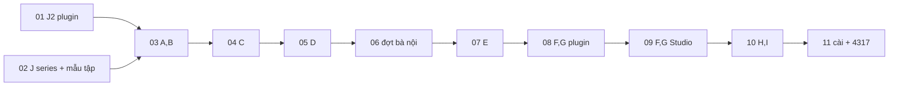

# Motion Studio làm trọn Sóng Lag tập 2

Kế hoạch bàn giao cho người thực hiện (executor) theo kiểu `--advice`: mỗi phase chia task có bước, tiêu chí thành công, phép kiểm (Verify) chạy được bằng lệnh, và quy trình xử lý khi Verify trượt. Hợp đồng đã được người dùng duyệt nằm ở `$C/docs/motion-studio-nang-cap-tap-2.md`; plan này không mở lại các quyết định trong đó. Chỗ nào mã thật khác tài liệu, plan đi theo mã và ghi lý do ở mục "Điểm tài liệu sai so với mã".

## Kết quả cần đạt

Khi xong plan này, người dùng mở Motion Studio ở `http://127.0.0.1:4317`, thấy dự án `a-02` của Sóng Lag, và làm được tập 2 chỉ bằng bấm trong Studio: duyệt bảng tài sản, đồng ý từng đợt tốn lượt, chọn người nói, lồng tiếng, duyệt nhóm cảnh, xuất bản final, giao nộp vào `S/kenh-youtube/tap-2/` và tải lên Drive. Executor chỉ dựng công cụ và chạy một bài kiểm thật là đợt vẽ bà nội; phần sản xuất tập 2 là danh sách việc của người dùng ở phase 11.

## Đường tắt và biến môi trường

Mọi lệnh trong các phase dùng các biến sau. Đặt chúng ở đầu mỗi lệnh shell, vì shell không giữ biến giữa các lần gọi.

```bash
C="/Volumes/2/Hoạt hình/content/261022-chuoi-kenh-ke-chuyen"
S="$C/series/song-lag"                 # kho series, KHÔNG phải git
MS=/Volumes/2/Motion-Studio            # repo abm-dungtq/motion-studio
OVC="$HOME/.cache/ms-tap2/opus-video"  # bản clone opus-video để sửa (git clone https://github.com/abm-dungtq/opus-video "$OVC"); không đặt ở /tmp vì macOS dọn /tmp khi khởi động lại và xóa file không chạm 3 ngày, đủ làm hỏng repo giữa một plan 60 giờ
OVI="$HOME/.claude/skills/opus-video"  # bản cài, CHỈ ĐỌC, chỉ cập nhật bằng npm run setup ở phase 11
T="$HOME/.cache/ms-tap2/thu"           # chỗ thử, dựng lại được bất cứ lúc nào (cùng lý do không dùng /tmp)
BK="/Volumes/2/Hoạt hình/plans/backups"
PLAN=/Volumes/2/Motion-Studio/plans/261024-1239-studio-series-tap-2
```

Studio để thử luôn chạy ở cổng 4420 với file trạng thái riêng, để không đè token của Studio 4317 đang chạy (pid trong `~/.config/motion-studio/studio.json`, root `/Volumes/2/Edit-Video`):

```bash
export MOTION_STUDIO_PORT=4420 MOTION_STUDIO_STATE="$T/studio.json" OPUS_VIDEO_HOME="$OVC"
node "$MS/bin/motion-studio.mjs" start --background --root "<root thử>"
node "$MS/bin/motion-studio.mjs" status
node "$MS/bin/motion-studio.mjs" stop     # luôn dừng khi xong task
```

`MOTION_STUDIO_PORT` chưa tồn tại; phase 03 thêm nó. Trước phase 03 không chạy Studio thử.

**Nhập thử a-01.** `manifest-import.mjs` không có chế độ chạy khô: nó luôn ghi `project.json` và lấy khóa `.opus/lock` (`OV/scripts/manifest-import.mjs:24-27`, mã thoát 6 khi đã có `project.json`). `$C/video/a-01` hiện chưa có `project.json`, nên chạy import trên đó là sửa a-01. Mọi phép "nhập a-01" trong plan chạy trên một bản chép mới, bằng hàm dưới đây (dán vào đầu lệnh shell; tham số là thư mục plugin, `$OVI` hoặc `$OVC`):

```bash
a01_import() { rm -rf "$T/a01-imp"; mkdir -p "$T/a01-imp"; rsync -a --exclude renders --exclude demo --exclude qa --exclude build --exclude .opus --exclude project.json "$C/video/a-01/" "$T/a01-imp/a-01/"; node "$1/scripts/manifest-import.mjs" --project "$T/a01-imp/a-01"; }
# ví dụ: a01_import "$OVC" > "$T/a01-import.txt" 2>&1; command grep '^WARN' "$T/a01-import.txt" | diff - "$PLAN/reports/a01-import-moc-warn.txt"
```

## Các phase

| # | Phase | Việc trong tài liệu | Repo / nơi sửa | Cỡ | Trạng thái |
|---|---|---|---|---|---|
| 01 | [Chuẩn hóa nhạc nền và SFX khi sinh](phase-01-plugin-chuan-hoa-nhac.md) | J2 | opus-video | 2h | done |
| 02 | [Pipeline series và mẫu tập mới](phase-02-series-pipeline-va-mau-tap.md) | J1, J3, J4, J5, J6, logo | kho series S | 8h | done |
| 03 | [Khai báo series và công cụ series](phase-03-khai-bao-va-cong-cu-series.md) | A, B | opus-video, Motion Studio, S | 6h | done |
| 04 | [Vẽ ảnh theo đợt](phase-04-ve-anh-theo-dot.md) | C | Motion Studio | 6h | done |
| 05 | [Tab Tài sản và bảng duyệt](phase-05-tab-tai-san-bang-duyet.md) | D | Motion Studio (ui) | 6h | done |
| 05b | [Xem rộng bảng duyệt](reports/phase-05b-xem-rong.md) (đề xuất ở `reports/kongming-checkpoint-phase-04-05.md` mục 6) | D | Motion Studio (ui) | 3h | done, [PR #29](https://github.com/abm-dungtq/motion-studio/pull/29) `a94fc4c` |
| 06 | [Bài kiểm thật: đợt vẽ bà nội](phase-06-bai-kiem-dot-ba-noi.md) | mốc bước 3 | a-02, S (dữ liệu) | 3h + máy | done |
| 07 | [Người nói và lồng tiếng theo vai](phase-07-nguoi-noi-long-tieng.md) | E | opus-video, Motion Studio, S | 8h | done (opus-video #7, motion-studio #30; giọng bà nội chờ người dùng chọn) |
| 08 | [Cảnh trong manifest và cổng tách hình/tiếng](phase-08-plugin-canh-va-cong-hinh-tieng.md) | F (plugin), G | opus-video | 4h | done ([opus-video #8](https://github.com/abm-dungtq/opus-video/pull/8) `062c309`) |
| 09 | [Dựng lại cảnh và duyệt theo nhóm](phase-09-studio-dung-lai-canh-duyet-nhom.md) | F (Studio), G (thẻ nghe lại) | Motion Studio, S | 5h | done ([Motion Studio #31](https://github.com/abm-dungtq/motion-studio/pull/31) `ab81a79`) |
| 10 | [Giao nộp và thẻ cần xử lý ngoài](phase-10-giao-nop-va-the-xu-ly-ngoai.md) | H, I | opus-video, Motion Studio, S | 9h | done ([opus-video #9](https://github.com/abm-dungtq/opus-video/pull/9) `6ae4fbf`, [Motion Studio #32](https://github.com/abm-dungtq/motion-studio/pull/32) `7db2350`) |
| 11 | [Cập nhật bản cài, chạy 4317, bàn giao](phase-11-cai-dat-chay-that-ban-giao.md) | bước 7 (chuẩn bị) | máy người dùng | 3h | done (plugin cài `6ae4fbf`, 4317 pid 38307; [việc người dùng](reports/viec-nguoi-dung-tap-2.md)) |

Tổng khoảng 60 giờ làm, cộng thời gian máy chạy Codex và render. Con số này nằm trong ước tính 6–8 ngày máy của tài liệu.

## Phụ thuộc



- 01 và 02 sửa hai nơi khác nhau (repo plugin và kho series). Phase 02 chỉ cần bản clone `$OVC` của task 1.0 để chạy `timing.mjs` và `make-demo.mjs`; ngoài điểm đó hai phase chạy song song được. Một executor thì làm 01 rồi 02.
- Mọi phase còn lại chạy tuần tự đúng thứ tự mục 8 của tài liệu: J → A,B → C,D → E → F,G → H,I. Không phase nào bắt đầu khi phase trước chưa qua Verify.
- Mỗi phase sửa Motion Studio có nhánh và PR riêng, merge vào `main` trước khi phase sau tạo nhánh mới, nên không có hai nhánh cùng sửa một file.
- Mỗi phase sửa plugin làm trong `$OVC`, nhánh riêng, PR vào `abm-dungtq/opus-video`, merge, rồi `git -C "$OVC" checkout main && git -C "$OVC" pull`. Studio thử đọc plugin qua `OPUS_VIDEO_HOME="$OVC"`. Bản cài `$OVI` chỉ đổi ở phase 11.

## Mốc dừng (từ mục 8 tài liệu)

1. Sau phase 06: nếu đợt bà nội chưa ra tờ nhân vật duyệt được từ Studio, ghi lại vào `reports/` và cho khâu dựng rig nhân vật đi đường thoát (Claude Code ở terminal). Các phase sau vẫn làm.
2. Bất kỳ phase nào làm `manifest-import` trên bản chép a-01 (hàm `a01_import`) báo lỗi hay thêm cảnh báo mới so với mốc ở phase 01: dừng, sửa trước khi đi tiếp.
3. Phải tăng `STUDIO_API`: dừng và hỏi kongming trước; nếu tăng thì sửa `NEED.maxStudioApi` của `lib/providers/opus-video.mjs` trong cùng đợt và test `tests/provider*.test.mjs`.

## Quy trình khi Verify trượt (Failure Protocol, áp dụng cho mọi task)

1. Dừng task. Không sửa test cho khớp, không thêm `skip`, không nới điều kiện kiểm.
2. Đọc đúng dòng lỗi. Nếu là lỗi gõ hay đường dẫn hiển nhiên trong chính thay đổi của mình, sửa một lần rồi chạy lại đúng lệnh Verify đó.
3. Trượt lần thứ hai, hoặc lỗi không giải thích được: gọi agent `kongming` qua công cụ giao việc, gửi: tên phase và task, lệnh Verify, 30 dòng cuối đầu ra, file và dòng đã sửa, những gì đã thử, và một câu hỏi cụ thể. kongming chỉ tư vấn; executor vẫn chịu trách nhiệm sửa.
4. Ghi một đoạn ngắn vào `$PLAN/reports/<phase>-su-co.md`: lỗi, nguyên nhân, cách sửa, lời khuyên đã theo.
5. Dừng hẳn và hỏi người điều phối khi: lỗi vẫn còn sau lời khuyên; cần xóa hay ghi đè dữ liệu không lấy lại được; cần sửa ngoài hai repo, kho series và dự án a-02; nhập lại a-01 thất bại.

## Ràng buộc chung (executor phải giữ ở mọi phase)

- Commit theo conventional commits, không nhắc AI hay Claude, không ghi mã phase, task hay mã kiểm trong code, tên test, commit. Chú thích trong mã giải thích bất biến, không giải thích plan.
- Không commit nhị phân (`*.mp4`, `*.mp3`, `*.png` sinh ra, `ui/dist`, `renders/`, `demo/`). Ảnh fixture nhỏ cho test chỉ dùng loại đã có trong `tests/fixtures/` hoặc sinh trong test.
- Không in, `cat`, `echo` khóa ElevenLabs, token Codex, token gws hay token Studio. Khi cần token Studio thử để gọi route, đọc vào biến bằng `node -e` và không in ra.
- Không dùng cổng 4317 để thử. Không restart 4317 trước phase 11.
- Không viết đường dẫn Sóng Lag (`Hoạt hình`, `song-lag`, `xaopako`) trong mã Studio hay plugin. Chúng chỉ nằm trong `S/studio-series.json`, BRIEF của dự án và tài liệu plan.
- Đạo diễn không được gọi `codex exec` hay script tùy ý. Không sửa `ALLOWED_TOOLS` của plugin.
- Không đọc hay liệt kê đường có đoạn `build/` (ví dụ `S/build/`, `a-01/build/`). Chạy `build-rig`, `sync-to-project` thì được. Máy có hook chặn lệnh shell chứa chuỗi tên thư mục package của npm và chuỗi `dist`; dùng `command grep` và tránh hai chuỗi đó trong lệnh.
- Không sửa gì trong `$C/video/a-01`. Mọi phép kiểm cần ghi vào a-01 chạy trên bản chép ở `$T/root/a-01`.
- Không xóa `assets/gen/raw/` của dự án nào.
- Việc tốn lượt Codex hay ElevenLabs chỉ chạy ở đúng task có nhãn "Tốn lượt". Người dùng đã cho chạy liên tục, nên người điều phối tự đồng ý thẻ cho bài kiểm thật đợt bà nội (phase 06) và đợt tạo mẫu giọng bà nội (phase 07). Ngoài hai chỗ đó, mọi phép kiểm dùng CLI giả trong `tests/fake-cli.mjs` hoặc ElevenLabs giả.
- Tiến trình nền: ghi pid và cổng mỗi khi mở, dừng khi xong task (`node "$MS/bin/motion-studio.mjs" stop` với đúng biến môi trường thử).

## Tiêu chí xong của cả plan

- Test hai repo xanh: `cd "$MS" && npm test` và `cd "$OVC" && node --test scripts/tests/*.test.mjs`; test series `cd "$S" && node --test tools/tests/*.test.mjs` cũng xanh.
- `a01_import "$OVI"` (bản chép, không ghi vào a-01) chạy, exit 0, không có dòng `WARN` nào ngoài danh sách mốc ghi ở phase 01; 43 câu có `speaker` đúng `scenes/roles.json` và `gate: "pass"`.
- Studio 4317 chạy bản mới, root vẫn là `/Volumes/2/Edit-Video`, có symlink `a-01`, `a-02` trỏ tới `$C/video/`; danh sách hiện `a-02` (sửa được), `a-01` ở dạng "Nhập dự án" (plan không nhập a-01, vì nhập là ghi `project.json` vào đó) và mọi dự án cũ của Edit-Video; tab Tài sản, ô người nói, thẻ duyệt nhóm cảnh, các nút giao nộp và thẻ cần xử lý ngoài.
- `S/characters/ba-noi/` có tờ nhân vật đã duyệt từ Studio (`approval.json` có `approved: true` và ngày), hoặc báo cáo mốc dừng ghi rõ vì sao khâu rig đi đường thoát.
- Mọi lần gọi Codex và ElevenLabs trong bài kiểm có biên nhận trong `.opus/receipts/` của a-02; quét biên nhận không thấy chuỗi giống token.
- `$PLAN/reports/viec-nguoi-dung-tap-2.md` có danh sách việc người dùng tự làm trong Studio cho tập 2.

Các tiêu chí về bản final tập 2 (qc-mp4 0 FAIL, -16…-12 LUFS, `S/kenh-youtube/tap-2/` đủ file, bản sao Drive) là kết quả của bước 7 do người dùng làm trong Studio, không phải của executor.

## Kiểm thử (ma trận)

| Lớp | Cái gì | Ở đâu |
|---|---|---|
| Unit plugin | chuẩn hóa nhạc, `validateSeries`, `speaker`, import vai và cổng, op `set_line_speaker`/`set_line_audio`/`set_scenes`, khóa kéo mép, `pictureHash`, cổng final theo hash, phụ đề từ `words.json` | `$OVC/scripts/tests/*.test.mjs` |
| Unit Studio | tìm series, `series_tool` từ chối cờ lạ và đường `..`, khóa nhiều chỗ của agent, đợt ảnh (CLI giả, hết lượt giữa chừng), thẻ đồng ý, duyệt bảng ghi `approval.json`/`DEMO.md`, `series_tts`, `voice_design`, `scene_rebuild`, `deliver_*`, `drive_upload` (gws giả), thẻ cần xử lý ngoài | `$MS/tests/*.test.mjs` |
| UI | tab Tài sản, phóng điểm ảnh, ô người nói, khóa kéo mép, thẻ duyệt nhóm cảnh, thẻ nghe lại, thẻ xử lý ngoài | `$MS/ui` (`tsc`, `vitest`) |
| Series | `cast-tts --mix-out`, `ui-card`, `new-episode`, `scene-preview` | `$S/tools/tests/*.test.mjs` |
| Tích hợp | Studio 4420 trên bản chép a-01 và trên a-02 | lệnh `curl` trong Verify từng phase |
| Thật | đợt vẽ bà nội (Codex), mẫu giọng bà nội (ElevenLabs) | phase 06, 07 |

## Điểm tài liệu sai so với mã

Đã kiểm bằng mã ngày 2026-10-24 (MS @8408c00, OV @4fbc815). Plan đi theo mã ở mọi điểm dưới đây.

1. **Studio chỉ thấy dự án là thư mục con trực tiếp của root** (`server.mjs:121-135`, `projectDir` ở `server.mjs:167-172`, `lib/tools.mjs:121-126`), và `projectsOf` dùng `Dirent.isDirectory()` nên một symlink tới thư mục không được liệt kê (dù `projectDir` dùng `statSync` mở được). Root đang là `/Volumes/2/Edit-Video` và nhiều route đọc theo root: `compressScript(root)` → `<root>/scripts/compress-final.sh` (`lib/config.mjs:66`, `server.mjs:509`), thư viện âm thanh `<root>/shared-assets/sfx` (`server.mjs:257`), Dự án mới `<root>/scripts/new-project.sh`, kéo footage `<root>/footage`, `<root>/shared-assets` (`routes/timeline-assets.mjs:79`). `$C/video` không có các thứ đó, nên đổi root sang `$C/video` làm "Xuất video" hỏng ở bước nén và mất các dự án Edit-Video. Quyết định: root 4317 giữ nguyên; phase 03 (task 3.3 bước 5) cho `projectsOf` nhận symlink; `series_episode_new` tạo tập cạnh thư mục thật của tập nguồn và tự nối symlink vào root (task 3.6); phase 06–10 chạy Studio thử trên root symlink `$T/root-series`; phase 11 chỉ tạo symlink `a-01`, `a-02` trong Edit-Video rồi `stop`/`start`.
2. **Cổng 4317 viết cứng** (`bin/motion-studio.mjs:37`) và file trạng thái dùng chung (`lib/config.mjs:36-37`). Chạy thử ở 4420 cần thêm `MOTION_STUDIO_PORT` (phase 03) và luôn đặt `MOTION_STUDIO_STATE` riêng, nếu không token của Studio 4317 bị ghi đè.
3. **Đạo diễn không ghi được file ngoài dự án.** `acceptEdits` chỉ cho ghi trong cwd (`director.mjs:5-6`, chú thích `ALLOWED_TOOLS` ở `scripts/studio-api.mjs:58-63`). Câu "đạo diễn có thể viết file chỉnh tay `S/characters/<id>/src/hd-*.mjs`" (mục 1, 5.2 bước 9) không đúng. Plan thêm tool `series_file_put` chép file từ dự án vào thư mục series được khai báo là ghi được (phase 03).
4. **Giới hạn song song ảnh có hai tầng.** Ngoài "một việc `image` mỗi dự án" (`jobs.mjs:24-27`, `routes/agents.mjs:41`), mỗi agent chỉ chạy một lượt trong một tiến trình (`lib/agents/index.mjs:159-167`, gọi ở dòng 184). Tập 1 chạy 4 việc song song qua một `codex-pool` với hai tài khoản (`S/spikes/gen-hd-poses.sh`, `xargs -P 4`), nên N không nhất thiết bằng số tài khoản. Plan cho khóa agent có N chỗ, mặc định bằng số tài khoản còn lượt như tài liệu, chỉnh được tới 4 (phase 04).
5. **Route ảnh chỉ nhận ảnh tham chiếu trong dự án** (`routes/agents.mjs:38`), còn đợt vẽ dùng `S/refs/...`. Đợt ảnh chạy trong tiến trình của Studio, kiểm ảnh tham chiếu theo thư mục đọc của series.
6. **Dấu cổng giọng nằm ở `assets/voice/NN.mp3.gate.json`**, còn câu trong manifest trỏ `assets/mix/voice-NN.mp3` (`a-01/index.html`, thẻ `<audio id="vo-01" src="assets/mix/voice-01.mp3">`). Import phải nối theo số `NN`, không theo `<mp3>.gate.json` cạnh file câu. Cổng là pass khi `stampMatches` của `script-md.mjs:44` khớp `script/NN.txt` và không có override.
7. **`visualHash` của `render-final.mjs:135-160` không gồm `scenes/`** (biểu thức `REF` ở dòng 83 chỉ bắt `src=`, `href`, `url()`, không bắt `import` của module), đúng như tài liệu nói. Nhưng nó gồm khối `TIMING` trong `index.html`, nên nếu cổng dùng thẳng nó thì lồng lại một câu vẫn FAIL chứ không WARN. Thêm nữa, cổng final hiện không dùng hash nào: nó so mtime của animatic với `index.html` và `compositions/*.html` (`check-preflight.mjs:264`, `newerThan` ở dòng 405-410). Plan thêm `pictureHash` riêng cho cổng: bỏ cả khối `TIMING` (dữ liệu sinh từ giọng và `PLAN.md`; `PLAN.md` vẫn được kiểm mtime riêng), cộng `scenes/` (phase 08). `visualHash` của `--audio-only` giữ nguyên để remux vẫn an toàn.
8. **Nơi gọi `buildFilm` đã tìm thấy:** module nội tuyến trong `a-01/index.html` (dòng 161-215), không nằm trong thư mục build. Trình duyệt dựng hình từ `window.TIMING` lúc chạy. Mục 10 "chưa kiểm chứng" của tài liệu đã giải.
9. **`check-palette` kiểm một thư mục khung PNG** (`S/tools/check-palette.mjs:2-4`, `--dir`), không phải một file nền. Nền không vẽ trên nền xanh nên không tách nền; nền đi qua `S/tools/quantize.mjs --w 480 --h 270` rồi `check-palette --dir … --scale 1`.
10. **Không có công cụ series biến ảnh thành đạo cụ `.pxl`.** `S/tools/import-sprite.mjs` làm thân nhân vật; đạo cụ tập 1 vẽ bằng `S/spikes/make-props-*.mjs`. Plan dùng `import-sprite --width` cho đạo cụ vẽ trên nền xanh và `ui-card` (J6) cho đạo cụ màn hình. `sync-to-project` cũng không chép nền (`S/tools/sync-to-project.mjs:16-23`); nền duyệt xong do Studio chép vào `assets/bg/`.
11. **`check-viet-pro --stage delivery` chạy trên `--project`** và đọc `CAPTIONS.md` của dự án (`scripts/check-viet-pro.mjs:29-39`); nó còn đòi `script-table.v1.md` và dấu cổng mọi `assets/voice/NN.mp3`. `CAPTIONS.md` phải nằm ở `video/a-02/` để qua cổng, rồi mới chép sang `tap-2/`.
12. **`export.mjs` ghi ra cạnh file vào** và tự lấy thumbnail từ khung demo (`scripts/export.mjs:14-18`). Giao nộp chạy với `--no-thumb` rồi chép sang `tap-N/`.
13. **Đã có bản nháp tiêu đề tập 2** ở `S/kenh-youtube/tap-2-tieu-de-mo-ta.md` (cùng tập 3–5). `deliver_text` lấy bản này làm nguồn nếu có.
14. **Giọng mới cần role trong `S/voices/roles.json` trước** (mảng có `description_en`, `sample_vi` 100–1000 ký tự; `S/tools/voice-design.mjs:17-31`). Bà nội chưa có trong `roles.json` lẫn `cast.json`.
15. **BRIEF của a-01 không có dòng `series:`**, chỉ có `## series_bible` với dòng "Thư mục series: …". Không sửa a-01, nên Studio đọc dòng đó làm đường dự phòng.
16. **Nút "Dự án mới" chạy `<root>/scripts/new-project.sh`**, không có trong `$C/video`, và khung chuẩn không phải dự án series. a-02 chưa có, mà đợt bà nội cần dự án a-02. Plan thêm mẫu tập và tool `series_episode_new` (phase 02, 03).
17. **Thẻ của đạo diễn chỉ có cổng `direction`, `animatic` hoặc trống** (`scripts/requests.mjs:19-20`). Thẻ đồng ý đợt, duyệt bảng, duyệt nhóm cảnh, nghe lại và cần xử lý ngoài là thẻ của Studio, không đi qua `studio_ask`, để khỏi đổi plugin.
18. **Đạo diễn đã chạy được mọi `node $OV/scripts/*`** (`scripts/studio-api.mjs:63`), kể cả `eleven.mjs` tốn lượt. Luật "đồng ý một lần mỗi đợt" vì vậy chỉ giữ được bằng luật trong prompt cho dự án series, không bằng quyền. Đây là rủi ro còn lại, ghi ở phase 07.
19. **Mục C kiểm "đợt 7 tư thế bà nội"**, trong khi kịch bản tập 2 (`$C/scripts/a-02-tai-khoan-facebook-dau-tien.md:268-269`) nói bà nội chỉ cần mức `design` và tư thế ngồi nghe điện thoại; 7 tư thế mới là của Sóng, bố, mẹ. Plan kiểm song song và hết lượt giữa chừng bằng đợt 7 ảnh với CLI giả, còn đợt thật là bà nội khoảng 4 ảnh trong hai đợt (thiết kế, rồi tư thế ngồi nghe điện thoại).
20. **`cast-tts` không ghi biên nhận**; tool Studio bọc nó ghi. Tên file khai báo là `S/studio-series.json` theo tài liệu, không phải `S/studio-tools.json` như báo cáo kongming.
21. **`manifest-import` không có chế độ chạy khô** (`OV/scripts/manifest-import.mjs:24-27`): nó luôn ghi `project.json`, và `a-01` chưa có file đó. Mọi phép "nhập a-01" chạy trên bản chép (hàm `a01_import` ở trên); a-01 hiện trong Studio ở dạng "Nhập dự án".
22. **Import tìm lời ở `script/<tên file>.txt`** (`manifest-import.mjs:158-161`), tức `script/voice-01.txt` với a-01, là file không có; lời a-01 hiện đến từ `words.json`. Phase 07 nối theo số `NN` cho cả lời, vai và cổng.
23. **`COMMANDS` của plugin chưa có `timing`, `mixBalance`, `export`, `vietPro`, `captions`, `platform`** (`OV/scripts/studio-api.mjs:34-48`). Các phase 07, 08, 10 thêm khóa, không đổi `STUDIO_API`. `check-viet-pro.mjs` nằm trong plugin; skill viet-pro chỉ có `lint-vietnamese-content.mjs` và `check-platform.mjs`.
24. **`setup` không lùi bản cài được** bằng `--ref` (chỉ `pull --ff-only`, `lib/providers/opus-video.mjs:142-200`); quay lại phải đi bằng commit revert trên `main`.
25. **Bảy tư thế mới của tập 2** là của Sóng, bố, mẹ, và tập 2 cần 6 nền mới, hơn 25 đạo cụ màn hình (`$C/scripts/a-02-tai-khoan-facebook-dau-tien.md:266-271`). Đó là việc của người dùng ở bước 7, có trong danh sách của phase 11.

## Rủi ro chính

| Rủi ro | Khả năng × tác động | Giảm thiểu |
|---|---|---|
| Rig bà nội không dựng được từ Studio | Cao × Trung bình | Đường thoát ở mốc dừng 1; thẻ cần xử lý ngoài ở phase 10 |
| Thay đổi schema làm lệch Studio và plugin | Trung bình × Cao | Chỉ thêm trường tùy chọn, `STUDIO_API` giữ 4, test nhập a-01 mỗi phase plugin |
| Hash cổng sai làm kẹt render final | Trung bình × Cao | Cờ `--legacy-mtime`, dự án cũ không có `visual_hash:` đi đường cũ |
| Studio thử ghi đè trạng thái Studio 4317 | Trung bình × Cao | Luôn đặt `MOTION_STUDIO_STATE`; Verify kiểm pid 4317 không đổi |
| Hết lượt Codex hay ElevenLabs giữa bài kiểm | Trung bình × Thấp | Thẻ ước tính trước, đợt nhỏ (khoảng 4 ảnh, 1 lần thiết kế giọng) |
| `hyperframes render -c` không nhận composition trong `demo/` | Trung bình × Trung bình | Task thăm dò đầu phase 09, có phương án dự phòng |
| Một route so đường symlink với `realpath` rồi từ chối file của a-02 | Thấp × Trung bình | Phase 06–10 chạy trên root symlink nên lộ sớm; đã rà các chỗ `realpathSync` trong `server.mjs`, `lib/tools.mjs`, `routes/fx.mjs`, `routes/lemo.mjs`, `lib/timing-edit.mjs` đều realpath cả hai vế |

## Khôi phục

- Repo: mỗi phase là một PR; quay lại bằng `git revert <merge>` trên `main`, rồi chạy lại test. Plugin chỉ vào bản cài ở phase 11; trước đó bản cài không đổi.
- Kho series: bản tar ở `$BK/song-lag-<ngày>.tgz` (phase 02) và các bản chép file lẻ ở `$BK/song-lag-<phase>-<ngày>/`. Giải nén vào thư mục tạm rồi chép lại đúng file, không giải đè cả kho.
- Studio 4317: nếu bản mới hỏng ở phase 11, revert PR gây lỗi trên `main` của Motion Studio (không checkout commit cũ trực tiếp), rồi `stop` và `start --background` (root không đổi) để về cách chạy cũ; hai symlink `a-01`, `a-02` là lối vào, xóa symlink không đụng dữ liệu. Plugin: setup chỉ `git pull --ff-only` và coi bản cài là mới khi HEAD đã chứa commit đích (`lib/providers/opus-video.mjs:142-200`), nên `--ref <commit cũ>` không lùi được. Muốn quay bản cài thì revert PR gây lỗi trên `main` của opus-video, rồi chạy lại `npm run setup -- --yes` để kéo commit revert.

## Câu hỏi còn mở

1. (Đã chốt khi duyệt plan 2026-10-24.) Studio chỉ phục vụ một root; thay vì đổi root sang `$C/video`, root giữ ở Edit-Video và các tập series nối vào bằng symlink (xem "Điểm tài liệu sai so với mã" mục 1). Studio nhiều root không nằm trong plan này.
2. Duyệt tờ nhân vật bà nội là quyết định hình ảnh. Plan cho người điều phối duyệt thay ở phase 06 theo lời dặn chạy liên tục, kèm ghi chú trong `approval.json`; người dùng vẫn bấm "Vẽ lại" được trong Studio. Chọn giọng bà nội trong 3 mẫu thì để người dùng nghe và chọn ở bước 7.
3. Tải thật lên Drive là gửi ra ngoài. Plan chỉ kiểm `drive_upload` bằng `--dry-run` và gws giả; lần tải thật đầu tiên là nút người dùng bấm khi giao tập 2.
